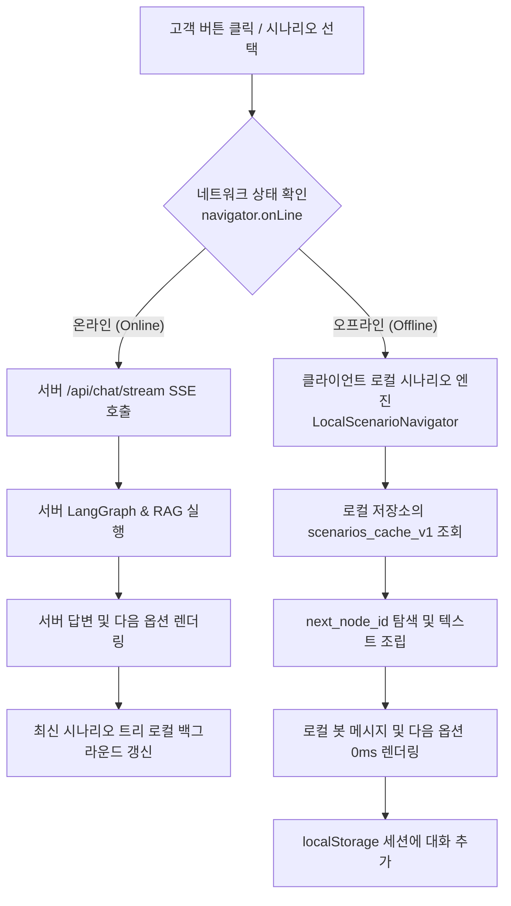

# 📶 [기능 설계 및 실행 계획서] 고객용 웹 챗봇 오프라인 자립 기능 구현 보고서
## : (1) 시나리오 트리 기반 안내 & (2) 최근 질의응답 이력 조회

> **문서 버전**: v1.0  
> **작성 일시**: 2026-10-13  
> **대상 도메인**: 고객용 챗봇 인터페이스 (`/client`)  
> **핵심 목표**: 인터넷 단절(오프라인 / 온프레미스 망분리 / 통신 장애) 환경에서도 **(1) 시나리오 트리 기반 장애 안내**와 **(2) 최근 질의응답 이력 조회**가 100% 정상 작동하도록 PWA 및 클라이언트 사이드 로컬 룰 엔진 구축

---

## 1. 📌 추진 배경 및 현황 분석 (As-Is vs To-Be)

### 1.1 현재 시스템의 오프라인 한계점 (As-Is)
1. **서버 의존적 시나리오 분기**:
   - 현재 시나리오 버튼(`ScenarioStrip`)을 클릭하면 서버의 `/api/chat/stream` 엔드포인트로 `action`을 전송하고, 백엔드의 LangGraph 런타임이 다음 노드를 판별하여 SSE 스트림으로 반환합니다.
   - 따라서 **네트워크가 끊기면 시나리오 버튼을 눌러도 `Failed to fetch` 오류가 발생하며 안내가 즉시 중단**됩니다.
2. **새로고침 시 앱 셸 로드 불가**:
   - 표준 웹 애플리케이션 구조이므로, 오프라인 상태에서 브라우저를 새로고침하거나 새로 접속하면 브라우저의 `인터넷에 연결되지 않음` 오류 화면이 노출됩니다.
3. **오프라인 상태에 대한 시각적 안내 부재**:
   - 현재 대화 이력(`useClientHistory`)은 `localStorage`에 저장되어 물리적으로 남아있으나, 통신 단절 시 챗봇이 먹통이 된 것처럼 보이며 명확한 오프라인 상태 안내가 없습니다.

### 1.2 목표 시스템의 완성형 모습 (To-Be)
```
┌──────────────────────────────────────────────────────────────────────────────────┐
│                   [고객용 웹 챗봇 오프라인 동작 아키텍처]                         │
│                                                                                  │
│   ┌──────────────────────────────────────────────────────────────────────────┐   │
│   │ 📶 오프라인 모드 안내 배너: "네트워크가 끊겼습니다. 시나리오 안내는 정상 이용 가능" │   │
│   └──────────────────────────────────────────────────────────────────────────┘   │
│                                                                                  │
│   ┌───────────────────────────┐          ┌───────────────────────────────────┐   │
│   │ [기능 1: 시나리오 트리]    │          │ [기능 2: 질의응답 이력 조회]        │   │
│   │ - 로컬 시나리오 엔진 내장  │          │ - localStorage 세션 완전 복원     │   │
│   │ - data/scenarios.json 캐싱│          │ - 이전 질의-답변 카드 즉시 열람   │   │
│   │ - 버튼 클릭 시 0ms 즉각반응│          │ - 세션 검색 및 대화 백업 유지     │   │
│   └───────────────────────────┘          └───────────────────────────────────┘   │
│                                                                                  │
│   ┌──────────────────────────────────────────────────────────────────────────┐   │
│   │ [기반 기술: PWA & Service Worker & IndexedDB/LocalStorage Cache]          │   │
│   │ - 새로고침/오프라인 접속 시에도 앱 셸(HTML/JS/CSS/이미지) 100% 로드 보장   │   │
│   └──────────────────────────────────────────────────────────────────────────┘   │
└──────────────────────────────────────────────────────────────────────────────────┘
```

---

## 2. 🧩 오프라인 작동을 위해 필요한 핵심 요소 (기술적 요구사항)

오프라인 상태에서 고객용 페이지가 완전히 자립하여 동작하기 위해 **4가지 핵심 기술 요소**가 필수적입니다.

### ① PWA 앱 셸 캐싱 (Service Worker & Cache Storage)
- **역할**: 오프라인 상태에서 브라우저를 켜거나 새로고침해도 웹 페이지(HTML, CSS, JS 번들, 아이콘, 폰트)가 즉시 로드되도록 정적 자원을 브라우저 캐시에 영구 보관.
- **도구**: `vite-plugin-pwa` (Workbox 기반의 정적 프리캐싱 체계 구축).

### ② 시나리오 트리 데이터 사전 동기화 (Client-Side Storage)
- **역할**: 백엔드의 `data/scenarios.json` 전체 트리 구조(루트, 질문 노드, 선택지 옵션, 최종 안내 답변)를 온라인 상태일 때 클라이언트 로컬 스토리지(`IndexedDB` 또는 `localStorage`)에 미리 저장.
- **용량**: 전체 시나리오 트리는 약 21KB 수준으로 모바일/PC 브라우저 스토리지에 부담 없이 0.1초 만에 캐싱 가능.

### ③ 클라이언트 사이드 시나리오 룰 엔진 (`LocalScenarioNavigator`)
- **역할**: 서버 API 호출 없이, 브라우저 메모리 상에서 사용자가 선택한 버튼(`option_id`)의 `next_node_id`를 추적하여:
  1. 다음 안내 문구(`text` 또는 `answer.text`)를 즉시 화면에 봇 메시지로 추가.
  2. 다음 하위 선택지 버튼 목록(`options`)을 `ScenarioStrip`에 렌더링.
  3. "처음으로" 선택 시 루트 노드로 리셋.
  4. 0ms 즉각 반응성 제공.

### ④ 실시간 네트워크 상태 감지 및 UX 상태 머신 (`useNetworkStatus`)
- **역할**: `navigator.onLine` 및 `window.addEventListener('online'/'offline')` 이벤트를 감지하여:
  - **오프라인 전환 시**: 상단 경고 띠 배너 표출, 텍스트 입력창 비활성화 또는 "오프라인 모드에서는 아래 시나리오 버튼을 이용해 주세요" 플레이스홀더 표시.
  - **온라인 복구 시**: "네트워크가 복구되었습니다" 토스트 알림 및 최신 시나리오 트리 자동 백그라운드 갱신.

---

## 3. 🛠️ 상세 구현 아키텍처 및 데이터 흐름

### 3.1 네트워크 상태에 따른 동적 라우팅 파이프라인



---

### 3.2 (기능 1) 시나리오 트리 기반 안내 오프라인 동작 메커니즘

1. **시나리오 트리 로컬 동기화 (온라인 상태 시)**:
   - 앱 구동 시 `/api/scenarios/root` 또는 `/api/admin/scenarios`를 백그라운드에서 1회 패치.
   - 응답받은 전체 JSON 데이터를 `localStorage.setItem('scenarios_tree_cache_v1', JSON.stringify(treeData))`에 안전 보관.
2. **오프라인 선택지 클릭 이벤트 (`handleSelectOption`)**:
   - 오프라인 상태일 때 `sendAction(opt)` 호출 시 서버 fetch를 건너뛰고 로컬 핸들러 작동:
     ```javascript
     // 로컬 시나리오 엔진 탐색 의사코드
     const cachedTree = JSON.parse(localStorage.getItem('scenarios_tree_cache_v1'));
     const nextNode = cachedTree.nodes[opt.next_node_id];
     
     // 화면에 사용자 선택 및 봇 답변 즉시 렌더링
     setMessages(prev => [
       ...prev,
       { id: 'user_' + Date.now(), type: 'user', text: '▶ ' + opt.label },
       { id: 'bot_' + Date.now(), type: 'bot', resp: {
           answer: nextNode.text || nextNode.answer?.text,
           options: nextNode.options || [],
           route: 'scenario_offline',
           answer_source: 'offline_cache'
       }}
     ]);
     setScenarioOptions(nextNode.options || []);
     ```
3. **터미널(최종) 노드 도착 시**:
   - 문제 해결 조치 방법("공유기 전원을 껐다 켜주세요", "콜센터 1899-0979로 연락바랍니다") 안내와 함께 `[처음으로]` 버튼을 제공하여 무한 순환 보장.

---

### 3.3 (기능 2) 최근 질의응답 이력 조회 오프라인 동작 메커니즘

1. **이력 저장 및 복원 (`useClientHistory.js` 고도화)**:
   - 이미 브라우저 `localStorage`(`chatbot_client_sessions_v1`)에 세션별 대화가 영구 보관 중이므로, 네트워크 단절과 무관하게 100% 온전히 보존됨.
2. **오프라인 이력 탐색 UI 강화**:
   - 좌측 사이드바(`ClientLayout.jsx`)의 세션 목록 클릭 시 로컬 세션 데이터를 0ms로 화면에 즉시 복원.
   - 세션 내부의 `type: 'user'`, `type: 'bot'` 메시지가 말풍선 형태로 깨끗하게 표출.
3. **오프라인 상태에서의 텍스트 질문 제어**:
   - 인터넷이 끊긴 상태에서 사용자가 텍스트 창에 직접 질문을 입력하고 전송할 경우:
     - ❌ 기존: 네트워크 에러 발생 후 빈 화면
     - ✅ 개선: 에러를 내지 않고 로컬 봇이 친절하게 안내:
       > *"📶 현재 인터넷 연결이 오프라인 상태입니다. 실시간 AI 검색 질의는 불가능하지만, **위의 시나리오 버튼 안내**나 **좌측의 지난 대화 이력**은 정상적으로 확인하실 수 있습니다."*

---

## 4. 📋 상세 구현 로드맵 (단계별 WBS)

| 단계 | 작업 항목 (Task) | 상세 내용 | 예상 산출물 |
| :---: | :--- | :--- | :--- |
| **Step 1** | **네트워크 상태 감지 훅 구현** | - `useNetworkStatus.js` 작성<br/>- 온라인/오프라인 실시간 상태 추적<br/>- API fetch 타임아웃 감지 로직 결합 | `frontend/src/hooks/useNetworkStatus.js` |
| **Step 2** | **시나리오 트리 로컬 캐싱 체계 구축** | - 백엔드 전체 트리 API(`/api/scenarios/offline-pack`) 엔드포인트 마련<br/>- 프론트엔드 최초 로드 시 트리 캐싱 로직 탑재 | `backend/app/api.py`<br/>`frontend/src/utils/scenarioCache.js` |
| **Step 3** | **클라이언트 로컬 시나리오 엔진 구현** | - `LocalScenarioNavigator.js` 엔진 개발<br/>- 오프라인 시 트리 순회, 노드 탐색, 옵션 생성<br/>- `useChatStream.js`에 오프라인 분기 처리 연결 | `frontend/src/utils/localScenarioNavigator.js`<br/>`frontend/src/hooks/useChatStream.js` |
| **Step 4** | **고객 화면(ClientLayout) 오프라인 UX 구현** | - 상단 오프라인 안내 배너 컴포넌트 추가<br/>- 텍스트 입력창 플레이스홀더 동적 변경<br/>- 이력 사이드바 오프라인 표시 뱃지 추가 | `frontend/src/components/ClientLayout.jsx`<br/>`frontend/src/components/OfflineBanner.jsx` |
| **Step 5** | **PWA & Service Worker 캐싱 설정** | - `vite-plugin-pwa` 구성 또는 커스텀 `sw.js` 등록<br/>- 정적 자원(HTML/CSS/JS/아이콘) Cache Storage 캐싱<br/>- 오프라인 새로고침 자립 동작 보장 | `frontend/vite.config.js`<br/>`frontend/public/manifest.json` |
| **Step 6** | **통합 검증 및 오프라인 시뮬레이션** | - Chrome DevTools [Network: Offline] 모드 테스트<br/>- 시나리오 10단계 연속 이동 검증<br/>- 과거 세션 5개 상호 전환 검증<br/>- 온라인 복구 시 자동 동기화 검증 | 테스트 결과서 & 빌드 번들 |

---

## 5. 💡 예외 처리 및 장애 대응 설계

1. **시나리오 트리 캐시가 없는 상태에서 최초 접속 시 오프라인인 경우**:
   - **대응책**: 프론트엔드 빌드 시 기본 표준 시나리오 트리(`defaultScenarios.json`)를 번들에 기본 임베딩(`fallback`)하여, 단 한 번도 서버에 접속하지 못한 완전 오프라인 첫 실행에서도 기본 시나리오 안내가 즉각 작동하도록 보장.
2. **스토리지 용량 초과 (`QuotaExceededError`) 방지**:
   - 대화 세션은 최대 50개까지만 유지하고, 오래된 세션부터 자동 정리(LRU 정책).
   - 시나리오 트리는 약 25KB에 불과하므로 용량 오류 발생 가능성 제로.
3. **네트워크 재연결(Online) 시 자동 복구**:
   - 오프라인에서 온라인으로 전환되는 즉시 상단에 `"네트워크가 연결되었습니다"` 녹색 토스트를 3초간 띄우고, 백그라운드에서 최신 시나리오 트리 및 RAG 상태를 무음 갱신.

---

## 6. 🏁 결론 및 기대 효과

1. **통신 장애 무중단 서비스 (100% 가용성 달성)**:
   - 교내 학내망 단절이나 통신사 회선 장애가 발생하여 챗봇을 찾는 바로 그 순간에도, **스쿨넷봇의 장애 조치 시나리오 안내는 중단 없이 100% 작동**합니다.
2. **기존 데이터 및 자산 100% 활용**:
   - 이미 구축된 `data/scenarios.json` 트리와 `useClientHistory`의 localStorage 자산을 그대로 승계하므로, **최소한의 리팩토링으로 가장 견고한 오프라인 시스템을 완성**할 수 있습니다.
3. **사용자 경험 극대화**:
   - 네트워크 연결 여부와 상관없이 0ms 즉각 반응하는 시나리오 탐색과 직관적인 과거 상담 이력 열람을 제공합니다.
