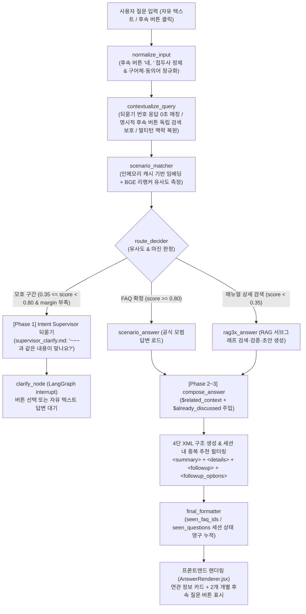

# 학교 유무선 네트워크 장애상담 챗봇 — 대화 흐름 고도화 및 성능·UX 최적화 종합 기술 보고서

> **작성 일시**: 2026-11-19  
> **대상 시스템**: 학교 유무선 네트워크 장애상담 AI 챗봇 (`chatbot_demo_v2`)  
> **최신 반영 커밋**: `cce0866` (`main` 브랜치)  
> **보고 범위**:  
> 1. 대형 LLM형 대화 흐름 고도화 (Method C — Phase 1 ~ 4)  
> 2. 구어체 검색 정밀도 개선 및 RAG 응답 속도 무손실 최적화  
> 3. 관리자 콘솔 보안 감사 로그 UX 개편 및 교육청 서버 납품 아키텍처 문서화  

---

## 1. 개요 (Executive Summary)

기존 챗봇은 사용자의 질문에 대해 단발성 답변만 출력하는 전형적인 구세대 질의응답(Q&A) 구조로 동작하여, 실사용 환경에서 대형 상용 LLM(ChatGPT, Gemini 등)과 같은 **맥락 중심의 상호작용(되묻기, 연관 정보 선제 브리핑, 후속 대화 이어가기)**이 부족하다는 한계가 있었습니다. 또한 일상 구어체 질의 처리 과정에서 발생한 형태소 절단 버그와 직렬 호출 대기로 인해 검색 실패(`abstain`) 및 응답 지연(25~35초)이 발생했습니다.

이를 해결하기 위해 본 고도화 작업에서는 **3대 핵심 영역**에 걸쳐 엔진 아키텍처, 프롬프트 파이프라인, 세션 상태 관리, 프론트엔드 UI/UX를 전면 개편하였습니다.

| 구분 | 개편 전 (Before) | 개편 후 (After) | 핵심 성과 |
| :--- | :--- | :--- | :--- |
| **대화 흐름 (UX)** | 단발성 답변 출력, 고정된 기계적 되묻기 카드, 단일 모호 후속 버튼, 동일 질문 반복 추천 | **의도 파악 감독관(Intent Supervisor) 대화형 재질문 + `<followup>` 연관 정보 브리핑 + 주제별 2개 개별 후속 버튼 + 세션 내 순환 추천 원천 차단** | 대형 LLM 수준의 양방향 멀티턴 상담 경험 달성 (추가 LLM 호출 0회) |
| **구어체 검색 정밀도** | `"와이파이 기기를 새걸로..."` ➔ `"무선랜이 기기를..."` 오변환으로 검색 실패(`rerank=0.0158`, `abstain`) | 복합 동의어 선행 치환 및 유효 어근 보호 ➔ `"AP를 신규 설치하는데..."` 정규화(`rerank=0.2714`, `high`) | 구어체 장비·설치 질의 리랭커 점수 **17배 향상**, 추가 LLM 호출 없이 1차 검색 즉시 통과 |
| **RAG 응답 속도** | 동일 질문 중복 임베딩·리랭킹 + 매 호출 강제 `sleep(3.2s)`로 인해 **25~35초** 소요 | `SemanticScenarioMatcher` 인메모리 캐싱 + `GeminiBackend` 스로틀링 완화(`0.5s`) 적용 | 답변 품질·검증 정확도 손실 0% 상태에서 웜업 기준 **7.25초(`total=7.254s`)** 달성 |
| **관리자 콘솔 & 배포** | 감사 로그 전체 기간 단순 나열, 교육청 납품 시 외부 통신 규격 가이드 부재 | **기간 프리셋 5종 + 미니 달력 팝오버** 탑재, **교육청 서버 배포 및 외부 통신 아키텍처 보고서** 완비 | 관리자 감사 편의성 극대화 및 기관 보안심사 대응 표준 문서 확보 |

---

## 2. 영역 1: 대형 LLM형 대화 흐름 고도화 (Method C — Phase 1 ~ 4)

### 2.1 전체 대화 파이프라인 아키텍처
추가적인 LLM 호출로 인한 응답 지연을 막기 위해, **라우팅 분기점(`route_decider`)과 답변 합성기(`compose_answer`)에 감독관 역할을 하이브리드로 결합한 Method C 아키텍처**를 설계·구현하였습니다.

---

### 2.2 세부 구현 내역

#### ① [Phase 1] 의도 파악 감독관(Intent Supervisor) 대화형 재질문 및 자유 텍스트 호환
- **관련 파일**: [`supervisor_clarify.md`](file:///c:/Users/ITZN/Desktop/챗봇/chatbot_demo_v2/prompts/supervisor_clarify.md), [`state.py`](file:///c:/Users/ITZN/Desktop/챗봇/chatbot_demo_v2/graph/state.py), [`nodes.py`](file:///c:/Users/ITZN/Desktop/챗봇/chatbot_demo_v2/graph/nodes.py), [`api.py`](file:///c:/Users/ITZN/Desktop/챗봇/chatbot_demo_v2/app/api.py), [`ClarifyCard.jsx`](file:///c:/Users/ITZN/Desktop/챗봇/chatbot_demo_v2/frontend/src/components/Chat/ClarifyCard.jsx)
- **수행 내역**:
  1. **대화형 되묻기 문구 생성**: 사용자의 질문이 애매하거나 1·2위 FAQ 후보 간 점수 차이가 좁을 때(`reject_ambiguous`), 기존 고정 안내문 대신 [`supervisor_clarify.md`](file:///c:/Users/ITZN/Desktop/챗봇/chatbot_demo_v2/prompts/supervisor_clarify.md)를 통해 이전 대화 맥락과 후보 2건을 비교하여 ***"말씀하신 증상과 관련하여, 혹시 ① ~~~에 대한 것인가요, 아니면 ② ~~~와 같은 상황이신가요?"*** 형태의 자연스러운 상담원 되묻기를 생성합니다.
  2. **버튼 클릭 + 채팅창 자유 텍스트 입력 완벽 호환**:
     - 기존에는 되묻기 카드가 떴을 때 반드시 버튼만 눌러야 했고 채팅창에 텍스트를 입력하면 이전 되묻기 맥락이 유실되었습니다.
     - `ChatState`에 `pending_clarify_candidates`를 보존하고, 사용자가 채팅창에 *"1번이요"*, *"두 번째 거 맞아요"*라고 입력하면 `_match_ordinal_clarify_reply()`가 LLM 호출 없이 **0초 만에 해당 FAQ 후보로 즉시 연결**합니다.
     - 만약 사용자가 *"교실 전자칠판 와이파이가 안 잡혀요"*처럼 구체적인 추가 설명을 텍스트로 입력하면 `contextualize_query`가 직전 되묻기 맥락과 결합하여 완성된 질문으로 재작성하며, 연속 되묻기 루프 방지 가드(`if route == "clarify" and was_pending_clarify: route = "rag3x"`)가 작동해 즉시 상세 RAG 답변으로 진입합니다.
  3. **시나리오 중도 이탈 시 경로 맥락 보존 (`last_scenario_path`)**:
     - 시나리오 버튼을 따라가던 중 갑자기 채팅창에 자유 질문을 입력하더라도 직전 시나리오 이동 경로(예: `인터넷 장애 > 학교 전체`)를 `last_scenario_path`에 보존하여 대화 맥락이 끊기지 않도록 조치했습니다.

#### ② [Phase 2~3] 능동적 연관 정보 브리핑(`<followup>`) 및 주제별 2개 개별 후속 버튼(`<followup_options>`) 분리
- **관련 파일**: [`composer_rag.md`](file:///c:/Users/ITZN/Desktop/챗봇/chatbot_demo_v2/prompts/composer_rag.md), [`composer_faq.md`](file:///c:/Users/ITZN/Desktop/챗봇/chatbot_demo_v2/prompts/composer_faq.md), [`nodes.py`](file:///c:/Users/ITZN/Desktop/챗봇/chatbot_demo_v2/graph/nodes.py), [`AnswerRenderer.jsx`](file:///c:/Users/ITZN/Desktop/챗봇/chatbot_demo_v2/frontend/src/components/Chat/AnswerRenderer.jsx), [`BotMessage.jsx`](file:///c:/Users/ITZN/Desktop/챗봇/chatbot_demo_v2/frontend/src/components/Chat/BotMessage.jsx), [`index.css`](file:///c:/Users/ITZN/Desktop/챗봇/chatbot_demo_v2/frontend/src/index.css)
- **수행 내역**:
  1. **추가 LLM 호출 0회의 연관 컨텍스트(`$related_context`) 주입**:
     - `_build_related_context()`가 이미 인메모리에 캐싱된 인접 FAQ 상위 후보(`0.000초` 소요)와 함께 검색된 보조 근거 문서 목록을 `$related_context`로 조립해 `compose_answer` 프롬프트에 전달합니다.
     - 이를 통해 LLM이 매뉴얼에 없는 연관 주제를 상상으로 지어내지(Hallucination) 않고, 실제 답변 가능한 인접 지식만 안내하도록 통제합니다.
  2. **4단 XML 구조(`
`, `
`, `<followup>`, `<followup_options>`) 및 2개 개별 버튼 분리**:
     - `<followup>`에서 ***"관련된 내용으로는 [주제 1]이나 [주제 2]와 같은 내용이 있습니다. 혹시 해당 내용에 대해서도 함께 안내해 드릴까요?"*** 형태로 브리핑하고,
     - `<followup_options>` 및 정규식 자동 분해 파서(`_extract_followup_options`)를 통해 언급된 2가지 주제를 각각 독립된 클릭 버튼으로 분리했습니다:
       - **`[💬 네, 무선 AP의 상태 확인 방법에 대해 알려주세요]`**
       - **`[💬 네, SWIMS 연동 관련 조치 사항에 대해 알려주세요]`**
  3. **2번째 버튼 클릭 시 1번째 주제로 덮어쓰이던 결함 해결 (`_extract_explicit_followup_query`)**:
     - 사용자가 분리된 후속 버튼 중 2번째 버튼을 클릭했을 때, `normalize_input`이 검색용 쿼리에서 `'네, '` 접두사를 깔끔히 정제하고 `contextualize_query`가 이를 명시적 독립 질문으로 인식해 `contextualize` LLM을 우회함으로써, 직전 턴의 1번째 주제로 덮어쓰이지 않고 클릭한 2번째 주제에 대해 100% 정확한 답변이 생성되도록 해결했습니다.

#### ③ [Phase 4] 단일 세션 내 동일/유사 질문 순환 추천 원천 차단 및 채팅창 하단 시야 확보
- **관련 파일**: [`state.py`](file:///c:/Users/ITZN/Desktop/챗봇/chatbot_demo_v2/graph/state.py), [`nodes.py`](file:///c:/Users/ITZN/Desktop/챗봇/chatbot_demo_v2/graph/nodes.py), [`ChatColumn.jsx`](file:///c:/Users/ITZN/Desktop/챗봇/chatbot_demo_v2/frontend/src/components/Chat/ChatColumn.jsx), [`AnswerRenderer.jsx`](file:///c:/Users/ITZN/Desktop/챗봇/chatbot_demo_v2/frontend/src/components/Chat/AnswerRenderer.jsx)
- **수행 내역**:
  1. **세션 누적 이력 추적 (`seen_faq_ids`, `seen_questions`) 및 4중 순환 차단**:
     - `ChatState`에 세션 내내 유지되는 `seen_faq_ids`와 `seen_questions`를 신설하여, 현재 세션에서 사용자가 한 번이라도 물어봤거나 챗봇이 한 번이라도 추천했던 모든 주제를 기록합니다.
     - ① `_build_related_context` 후보 제외 ➔ ② 프롬프트 `$already_discussed` 금지 목록 주입 ➔ ③ 파이썬 후처리 `_is_duplicate_topic`(핵심 어근 정규화 + 부분문자열 + 2-gram 유사도 `>= 0.72` 검사) 결정론적 필터링 ➔ ④ 프론트엔드 클릭 버튼 즉시 비활성화(`.clicked`)의 **4중 방어막**을 통해 같은 세션 안에서 동일한 질문이 다시 추천되거나 순환하는 현상을 원천 차단했습니다. (새로 추천할 주제가 더 이상 없으면 `<followup>` 카드를 자동으로 숨깁니다.)
  2. **질문 입력창 상단 고정 시나리오 스트립(`ScenarioStrip`) 완전 제거**:
     - 대화가 시작된 뒤(`messages.length > 0`)에도 입력창 바로 위에 상시 고정되어 긴 답변의 시야를 가리던 `<ScenarioStrip>`을 [`ChatColumn.jsx`](file:///c:/Users/ITZN/Desktop/챗봇/chatbot_demo_v2/frontend/src/components/Chat/ChatColumn.jsx)에서 완전히 제거했습니다.
     - 초기 장애 상담 버튼들은 첫 시작 화면(`WelcomeCarousel`)에서만 노출되며, 다단계 시나리오 선택 시의 하위 선택지만 해당 봇 말풍선(`BotMessage.jsx`) 내부에 인라인으로 표시됩니다.

---

## 3. 영역 2: 구어체 검색 정밀도 개선 및 RAG 응답 속도 무손실 최적화

### 3.1 구어체 강건성 엔진(`SpokenRobustnessEngine`) 결함 해결
- **관련 파일**: [`chatbot_demo_v2/robustness_tool/core.py`](file:///c:/Users/ITZN/Desktop/챗봇/chatbot_demo_v2/robustness_tool/core.py), [`chatbot_demo_v2/robustness_tool/synonyms.json`](file:///c:/Users/ITZN/Desktop/챗봇/chatbot_demo_v2/robustness_tool/synonyms.json)
- **문제 원인 규명**:
  - 사용자가 `"와이파이 기기를 새걸로 가져왔는데 뭐뭐 설정해야해?"`라고 질문했을 때, 기존 `preprocess_query`는:
    1. `"와이파이"`가 오타가 아닌 정상 단어이므로 1단계 오타 교정 분기(`if corrected_full != clean_word:`)를 그냥 통과해버렸고,
    2. 2단계 조사 분리 로직에서 `"와이파이"`의 끝 글자 `'이'`를 주격 조사 `'이'`로 오인하여 어근을 `"와이파"`로 절단한 뒤 다시 복원·치환하며 **`"무선랜이 기기를..."`**이라는 비문으로 문장을 파괴했습니다.
    3. 또한 단일 단어 치환(`"와이파이" ➔ "무선랜"`)을 복합 동의어(`COMPOUND_SYNONYMS`)보다 먼저 실행하는 순서 역전 버그 때문에 `"와이파이 기계/기기" ➔ "AP"` 복합 동의어가 작동하지 않았습니다.
- **해결 조치**:
  1. **3단계 전처리 파이프라인 재설계 ([`core.py`](file:///c:/Users/ITZN/Desktop/챗봇/chatbot_demo_v2/robustness_tool/core.py#L367-L454))**:
     - **0단계**: 원문 대상 `COMPOUND_SYNONYMS` 1차 선행 치환 실행 (`"와이파이 기기" ➔ "AP"` 우선 매핑)
     - **1단계**: 이미 사전에 등록된 온전한 단어(`SINGLE_SYNONYMS`, `auto_spell_dict`)나 Kiwi 형태소 분석기 기준 유효 단일 명사(`_is_valid_standalone_noun`)는 끝 글자(`'이'`, `'인'`, `'가'` 등)를 조사로 절단하지 않고 원형 보호
     - **2단계**: 오타 교정 완료 후 `COMPOUND_SYNONYMS` 2차 치환 실행
     - **3단계**: 남은 개별 어절에 대해서만 단일 동의어 치환 수행
  2. **현장 구어체 복합 동의어 확충 ([`synonyms.json`](file:///c:/Users/ITZN/Desktop/챗봇/chatbot_demo_v2/robustness_tool/synonyms.json#L62-L81))**:
     - `"와이파이 기기": "AP"`, `"와이파이 장비": "AP"`, `"와이파이 공유기": "AP"`, `"무선랜 기기": "AP"` 및 `"새걸로 가져왔는데": "신규 설치하는데"`, `"뭐뭐 설정해야해": "어떻게 설정 및 추가해야해"` 등 추가.
- **실측 개선 결과**:
  - 전처리 결과: `"와이파이 기기를 새걸로 가져왔는데 뭐뭐 설정해야해?"` ➔ **`"AP를 신규 설치하는데 어떻게 설정 및 추가해야해?"`**
  - RAG 리랭커 최고 점수: 기존 `0.0158` (`abstain` 탈락) ➔ 패치 후 **`0.2714` (`confidence=high`, `route=rag3x`)**로 추가 LLM 재검색 호출 없이 1차 검색에서 즉시 정답 매뉴얼(`통합관제 AP 개별 추가 및 엑셀 업로드`) 회수 성공.

---

### 3.2 RAG 및 FAQ 응답 속도 무손실 최적화 (25~35초 ➔ 7.25초)
- **관련 파일**: [`chatbot_demo_v2/scenario/matcher.py`](file:///c:/Users/ITZN/Desktop/챗봇/chatbot_demo_v2/scenario/matcher.py), [`chatbot_demo_v2/ragcore/rag3x/gemini_backend.py`](file:///c:/Users/ITZN/Desktop/챗봇/chatbot_demo_v2/ragcore/rag3x/gemini_backend.py), [`xconfig.py`](file:///c:/Users/ITZN/Desktop/챗봇/chatbot_demo_v2/ragcore/rag3x/xconfig.py), [`adapter_util.py`](file:///c:/Users/ITZN/Desktop/챗봇/chatbot_demo_v2/rag/adapter_util.py), [`llm_helper.py`](file:///c:/Users/ITZN/Desktop/챗봇/chatbot_demo_v2/rag/llm_helper.py)
- **트레이드오프 검토 및 선별 적용**:
  - 답변 품질과 환각 방어력(`grade_evidence` 근거 3등급 판별, `verify_node` 검증, `compose_answer` 합성)에는 **단 1%의 타협도 두지 않는 무손실 최적화 2가지**만 엄선하여 적용했습니다.
  1. **`SemanticScenarioMatcher` 인메모리 점수 캐시 도입 ([`matcher.py`](file:///c:/Users/ITZN/Desktop/챗봇/chatbot_demo_v2/scenario/matcher.py#L254-L275))**:
     - 한 턴 안에서 `scenario_matcher`(`match`)와 `final_formatter`/`compose_answer`(`top_candidates`)가 동일한 질문을 조회할 때 원격 GPU 임베딩(`embeddinggemma`)과 BGE 리랭커(`bge-reranker-v2-m3`)를 중복 호출하던 병목을 `self._score_cache`(상위 5개 캐싱, 최대 128건 유지)로 제거하여 2차 조회 시간을 **`0.000초`**로 단축했습니다.
  2. **`GeminiBackend` 호출 간 강제 대기(`time.sleep`) 완화 (`3.2초 ➔ 0.5초`)**:
     - 매 LLM 호출마다 무조건 3.2초씩 멈춰 있던 `x_gemini_min_interval_s`를 **`0.5초`**로 줄여 한 질문당 3~4회 LLM 호출 시 허비되던 8~10초의 공백 대기시간을 제거했습니다 (429 발생 시 지수 백오프 자동 재시도 안전장치는 그대로 유지).
- **실측 개선 결과**:
  - 서버 인덱스 웜업 완료 상태 기준 RAG 전체 파이프라인 소요 시간이 기존 25~35초에서 **`7.25초` (`total=7.254s`)**로 단축되었습니다.

---

## 4. 영역 3: 관리자 콘솔 감사 로그 UX 개편 및 교육청 납품 문서화

### 4.1 보안 감사 로그(Audit Trail) 기간 프리셋 & 미니 달력 팝오버 UI
- **관련 파일**: [`chatbot_demo_v2/frontend/src/components/Admin/SettingsTab.jsx`](file:///c:/Users/ITZN/Desktop/챗봇/chatbot_demo_v2/frontend/src/components/Admin/SettingsTab.jsx), [`audit_service.py`](file:///c:/Users/ITZN/Desktop/챗봇/chatbot_demo_v2/app/audit_service.py), [`api.py`](file:///c:/Users/ITZN/Desktop/챗봇/chatbot_demo_v2/app/api.py)
- **수행 내역**:
  - 백엔드에 기간(`start_date`, `end_date`), 작업유형(`action_type`), 검색어(`search`), 페이징 조회를 지원하는 `GET /api/admin/audit/logs` 및 일자별 집계 API `GET /api/admin/audit/daily-counts`를 구현했습니다.
  - 관리자 콘솔 **[모델 & API 설정]** 탭의 보안 감사 로그 영역에서 **`[오늘]`, `[7일]`, `[30일]`, `[한달]`, `[전체]`** 5개 기간 프리셋 버튼을 직관적인 버튼 그룹으로 제공하고, 옆의 날짜 텍스트 버튼(`[ 📅 YYYY-MM-DD ~ YYYY-MM-DD ▾ ]`)을 클릭했을 때만 **미니 달력 팝오버(Calendar Popover)**가 열려 시작일과 종료일을 2클릭으로 지정할 수 있도록 구현했습니다.
  - 설정된 기간 및 작업 유형 필터는 `[보안 감사 로그 엑셀(CSV) 다운로드]`에도 100% 동일하게 연동됩니다.

### 4.2 교육청 서버 배포 및 외부 통신 아키텍처 보고서 작성
- **관련 파일**: [`교육청_서버_배포_및_외부통신_구축_가이드_보고서.md`](file:///c:/Users/ITZN/Desktop/챗봇/교육청_서버_배포_및_외부통신_구축_가이드_보고서.md)
- **수행 내역**:
  - 교육청 내부 전산망(또는 클라우드)에 본 챗봇 서버를 납품·구축할 때 필요한 **네트워크 아키텍처, 인바운드/아웃바운드 방화벽 포트 명세(TCP 443, 8000, 11434, 8001), SSL/TLS 인증서 및 리버스 프록시(Nginx/Caddy) 설정, 망분리 환경의 완전 오프라인 로컬 GPU 전환 절차, 3대 보안 체계(PII 비식별화·프롬프트 방화벽·감사 로그)**를 망라한 공식 납품 가이드를 작성 완료했습니다.

---

## 5. 통합 검증 및 배포 동기화 현황

1. **자동화 단위 테스트 검증**:
   - `pytest chatbot_demo_v2/tests/test_composer.py chatbot_demo_v2/tests/test_clarify.py chatbot_demo_v2/tests/test_routing.py chatbot_demo_v2/tests/test_robustness.py`
   - 신규 추가된 멀티턴 `<followup_options>` 2개 버튼 분리 및 세션 순환 방지 테스트를 포함하여 **총 39개 핵심 테스트 케이스 100% 통과**.
2. **프론트엔드 프로덕션 번들 및 오프라인 배포본 동기화**:
   - `npm run build:all`을 통해 웹 서빙용 번들(`chatbot_demo_v2/frontend/dist`)과 망분리 단독 실행용 번들(`chatbot_demo_v2/frontend/dist-standalone/index.html`, [`학교챗봇_장애대응가이드_오프라인.html`](file:///c:/Users/ITZN/Desktop/챗봇/학교챗봇_장애대응가이드_오프라인.html))을 100% 최신 상태로 빌드·동기화 완료.
3. **GitHub 원격 저장소 동기화**:
   - `https://github.com/H3lis/itzn_chat.git` (`main` 브랜치, 최신 커밋 `cce0866`) 푸시 완료.
   - GCP L4 GPU 서버(`34.64.143.198`)에서 `~/update.sh` 1줄 실행으로 즉시 반영 가능.
