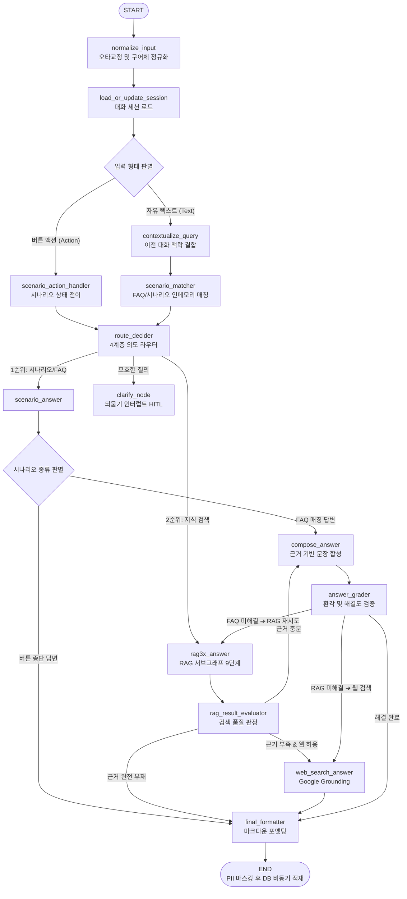

# 🏛️ [논문 집필용 학술 기술 백서] 생성형 AI 기반 하이브리드 장애상담 챗봇 시스템 아키텍처 및 구현 명세 총람
## : 무인터넷 자립형 0ms 룰 엔진, 3단계 하이브리드 PII 비식별화, CRAG 검증-롤백 RAG 및 Zero-Trust 관리 거버넌스

> **문서 번호**: SPEC-2026-PAPER-CORE-001  
> **발간 일자**: 2026년 10월 26일  
> **프로젝트 책임자**: Lead AI Research Engineer / Head of System Architecture  
> **대상 리포지토리**: `H3lis/itzn_chat` (`chatbot_demo_v2`)  
> **문서 목적**: 학술 논문(KCI/SCIE급) 작성을 위한 전체 구현 기술, 알고리즘, 파이프라인, 정량적 실험 결과 및 운영 메커니즘 전수 집대성 근거 자료  

---

## 📑 목차 (Table of Contents)

1. **[연구 배경 및 문제 정의]** 공공·교육기관 네트워크 장애 대응의 4대 기술적 난제
2. **[전체 시스템 아키텍처]** 하이브리드 3-Tier 런타임 및 인프라 서빙 구조
3. **[AI 모델 및 임베딩·리랭킹 스택]** sLLM, LLM, 임베딩 및 크로스인코더 명세
4. **[오케스트레이션 및 의도 라우팅]** LangGraph 기반 14노드 메인 그래프 제어 메커니즘
5. **[RAG 모듈 세대별 진화 및 9단계 서브그래프]** MinerU 파싱, 하이브리드 검색, CRAG 및 결정론 롤백
6. **[구어체 및 자소 오타 강건성 엔진]** 유니코드 자소 분해, 다메라우-레벤슈타인 및 듀얼 컨텍스트
7. **[3단계 하이브리드 PII 비식별화 시스템]** 8,344건 전수 벤치마크, 혼동 행렬 및 소거 연구
8. **[네트워크 단절 대비 0ms 오프라인 자립 시스템]** Quad-Zero 원칙, Singlefile 패키징 및 PWA/SW
9. **[Zero-Trust 관리자 거버넌스 및 다계층 보안]** bcrypt, RFC 7519 JWT, IPS 침입방지 및 BIPIA 가드레일
10. **[관리자 통합 포털 5대 핵심 기능 명세]** FAQ 핫리로드, RAG 메타데이터, 시나리오 트리 에디터
11. **[논문 투고를 위한 핵심 학술 기여도 및 토의]** 논문 섹션별 배치 전략 및 기대 효과
12. **[부록]** 핵심 소스코드 파일 및 데이터셋 디렉터리 맵

---

## 1. 🎯 [연구 배경 및 문제 정의] 공공·교육기관 네트워크 장애 대응의 4대 기술적 난제

초·중·고등학교 및 교육 행정 기관은 학내망(유선 LAN), 스마트 스쿨넷(무선 Wi-Fi AP), 행정 전용망(NEIS/K-에듀파인)이 물리적·논리적으로 분리된 고도의 보안 망분리 환경을 유지한다. 이러한 특수 환경에서 네트워크 장애가 발생했을 때 기존 생성형 AI 및 RAG 챗봇 시스템을 도입하는 데에는 다음과 같은 **4대 치명적 기술적 한계**가 존재한다:

```
┌─────────────────────────────────────────────────────────────────────────────────────────────────┐
│                     [공공·교육기관 챗봇 도입 시 직면하는 4대 기술적 난제]                       │
├──────────────────────────┬──────────────────────────┬──────────────────────────┬────────────────┤
│ 1. 닭과 달걀 딜레마      │ 2. 구어체·오타 검색 누락 │ 3. 개인정보(PII) 유출 위험│ 4. 매뉴얼 복합 도표 판독│
│    (Chicken-and-Egg)     │    (Spoken Typo Failure) │    (Privacy Violation)   │    (Visual Parsing)    │
├──────────────────────────┼──────────────────────────┼──────────────────────────┼────────────────┤
│ 네트워크 장애를 해결하려 │ "와파가 자꼬 끈켜요" 등   │ 대화 중 교사 실명, 교실 │ 네트워크 구성도, 장비   │
│ 면 챗봇에 접속해야 하나, │ 사투리/비정형 오타 입력  │ IP, 연락처 노출 시 법적  │ LED 상태표 등 조밀 도표 │
│ 인터넷이 끊겨 브라우저   │ 시 키워드 검색 실패로    │ 처벌 대상. 기존 LLM은   │ 오독 시 치명적인 조치   │
│ 에러 발생 (웹 챗봇 무력화)│ 치명적 검색 누락 발생    │ 과잉 마스킹 or 유출 결함 │ 오류 및 환각 초래      │
└──────────────────────────┴──────────────────────────┴──────────────────────────┴────────────────┘
```

1. **네트워크 단절 상황의 챗봇 딜레마 (Chicken-and-Egg Problem)**:
   - 교직원이 네트워크 장애를 해결하기 위해 챗봇을 찾지만, 정작 인터넷이 안 되어 웹 챗봇 자체가 열리지 않거나, 열려 있더라도 서버 통신이 불가능하여 에러 화면(`ERR_INTERNET_DISCONNECTED`)만 노출됨.
2. **비정형 구어체 및 자모 오타로 인한 RAG 검색 누락**:
   - 현장 사용자는 매뉴얼의 표준 기술 용어(예: "무선랜 품질장애", "PoE 인젝터 링크다운") 대신 일상 구어체("와파가 자꼬 끈켜여", "천장 공유기 불 꺼짐")를 입력하여 임베딩 및 키워드 매칭이 급격히 실패함.
3. **엄격한 개인정보보호법에 따른 비식별화 무누락 의무**:
   - 공공기관 특성상 상담 로그에 교직원 실명, 전화번호, 학내망 내부 IP, 시스템 계정 등이 평문 저장될 경우 법적 처벌 대상이 되며, 외부 상용 LLM에 그대로 전송될 경우 개인정보 역외 유출 문제가 발생함.
4. **네트워크 매뉴얼의 조밀한 표·도표 래스터 그래픽 파싱 난제**:
   - 네트워크 스위치 포트 맵, LED 점등 패턴, 네트워크 구성도는 단순 텍스트 추출기로 읽어낼 수 없으며, 일반 VLM은 조밀한 표의 숫자를 빈번히 오독(8회 중 4회 오독)하여 잘못된 장애 조치 명령을 하달함.

---

## 2. 🏛️ [전체 시스템 아키텍처] 하이브리드 3-Tier 런타임 및 인프라 서빙 구조

본 시스템은 **"온라인 정상 상태에서는 고성능 클라우드 LLM과 실시간 검색을 활용하고, 인터넷 단절 상태에서는 로컬 0ms 룰 엔진으로 100% 자립 동작하는 하이브리드 복원 탄력성(Resilience)"**을 핵심 설계 철학으로 삼는다.

```
=========================================================================================================================================================================
사용자 (클라이언트)  │          UI / 관리자 포털         │      AI Agent & 오케스트레이션       │        GPU / AI 모델 서빙         │           데이터 레이어           │       네트워크 및 인프라
=========================================================================================================================================================================
                     │  [ 대화형 포털 (사용자) ]         │  [ LangGraph 메인 에이전트 ]         │  [ AI 모델 서빙 (로컬 / GCP) ]    │  [ 지식 저장소 (문서/시나리오) ] │  [ 호스팅 인프라 (2가지 운영 방식) ]
 [ 교직원 / 사용자 ] │  ┌─────────────────────────────┐  │  ┌────────────────────────────────┐  │  ┌─────────────────────────────┐  │  ┌─────────────────────────────┐  │  ┌─────────────────────────────┐
        🧑‍🏫          │  │ • 장애 상담 대화창 (SSE)    │  │  │ • 14노드 오케스트레이션        │  │  │ • Docker: Ollama 서빙       │  │  │ • raw_data/documents/ (PDF) │  │  │ [방법 1] 로컬 PC 단독 운영   │
                     │  │ • 버튼형 시나리오 선택      │  │  │ • Intent 라우터 (FAQ/RAG/시나리오)│  │ • BGE Reranker 서버 (:8008)  │  │  │ • data/scenarios.json (트리) │  │  │   • 로컬 자립 구동 (:8002)    │
                     │  │ • 근거 문서 및 이미지 뷰어  │  │  │ • 강건성 엔진 (오타교정/구어체)│  │  │ • PyTorch CUDA 12.x 가속    │  │  │ • data/faq.json (질답 236건) │  │  │ -----------------------------│
                     │  │ • 👍/👎 만족도 피드백      │  │  │ • 되묻기 인터럽트 (HITL Clarify)│  │  └─────────────────────────────┘  │  └─────────────────────────────┘  │  │ [방법 2] GCP GPU VM 단독운영 │
                     │  └─────────────────────────────┘  │  │ • 환각 가드레일 (Grader)        │  │                                  │                                  │  │   • L4 GPU 올인원 구동 (가속) │
 ─────────────────── │                                   │  └────────────────────────────────┘  │  [ AI 모델 레이어 ]               │  [ 메타데이터 & 이력 저장소 ]    │  │   • 포트 80 (HTTP 임시) /    │
 [ 접속 채널 ]       │  [ RAG/챗봇 관리자 콘솔 (5대기능)]│                                      │  ┌─────────────────────────────┐  │  ┌─────────────────────────────┐  │  │     포트 8002 운용            │
 ┌─────────────────┐ │  ┌─────────────────────────────┐  │  [ RAG 서브그래프 (9단계) ]          │  │ • sLLM: Qwen2.5:3B / Gemma  │  │  │ • document_metadata.json       │  │  │ -----------------------------│
 │ • 웹 브라우저   │ │  │ [1] FAQ 조회/등록/수정/삭제 │  │  ┌────────────────────────────────┐  │  │ • LLM: Gemini 3.1 Flash-Lite│  │  │   (요약/키워드/카테고리/발행)│  │  │ [향후 목표] 전용 정식운영서버│
 │ • 모바일 앱     │ │  │     (저장 시 즉시 핫리로드) │  │  │ • 다중 문서 검색 & RRF 병합   │  │  │ • Embedding: embeddinggemma │  │  │ • chat_history.db (비식별화) │  │  │   (행정망 온프레미스/전용망) │
 │   (Flutter iOS/ │ │  │ [2] RAG 문서/전처리파이프   │  │  │ • 크로스 인코더 리랭킹 (BGE)   │  │  │ • Reranker: BGE-Reranker-v2│  │  │   (일자별 질의응답 이력)     │  │  └─────────────────────────────┘
 │    Android)     │ │  │     및 메타데이터 뷰어/편집 │  │  │ • 근거 종합 작문기 (Composer)  │  │  └─────────────────────────────┘  │  └─────────────────────────────┘  │  [ 방화벽 및 접속 포트 ]
 └─────────────────┘ │  │ [3] 웹 검색 Grounding 토글  │  │  └────────────────────────────────┘  │                                  │                                  │  ┌─────────────────────────────┐
                     │  │ [4] 버튼형 시나리오 에디터  │  │                                      │  [ 외부 검색 모델 ]               │  [ 벡터 저장소 (Vector Layer) ]  │  │ • 로컬 운영: :8002          │
 ─────────────────── │  │     (시나리오 트리 시각화)  │  │  [ LLMOps / 보안 모니터링 ]          │  ┌─────────────────────────────┐  │  ┌─────────────────────────────┐  │  │ • GCP 운영: :8002 / :80     │
 [ 통신 프로토콜 ]   │  │ [5] 일자별 대화이력 검색    │  │  ┌────────────────────────────────┐  │  │ • Google Search Grounding   │  │  │ ⚡ FAQ 인메모리 벡터/텍스트 │  │  │ • 정식 운영 목표: HTTPS :443│
 • HTTP/HTTPS        │  │     및 개인정보 비식별화    │  │  │ • LangSmith 분산 트레이싱       │  │  │   (내부 문서 부재 시 보완) │  │  │   (data/faq.json 기반 매칭)   │  │  └─────────────────────────────┘
 • SSE (스트리밍)    │  │ • 시스템 대시보드 및 지표   │  │  │ • 일일 토큰/비용 추적          │  │  └─────────────────────────────┘  │  │   ➔ 1ms 초고속 코사인 검색 │  │
 • RESTful JSON API  │  └─────────────────────────────┘  │  │ • 런타임 엔진 무중단 핫리로드   │  │                                  │  │ 📦 RAG FlatChunkIndex         │  │  [ 백업 및 보안 감사 ]
                     │                                   │  │ • 3단계 개인정보(PII) 마스킹    │  │                                  │  │   (vectors.npz + docs.json)   │  │  ┌─────────────────────────────┐
                     │  [ Web / App Proxy WAS ]          │  │ • 악의적 프롬프트(BIPIA) 가드레일│  │                                  │  │   ➔ Kiwi BM25 + Dense Hybrid │  │  │ • ragdata/ 파싱 캐시 백업 │
                     │  ┌─────────────────────────────┐  │  └────────────────────────────────┘  │                                  │  │ ※ 대규모 확장용 Vector DB    │  │  │ • .env 설정 백업           │
                     │  │ • FastAPI ASGI (Uvicorn)    │  │                                      │                                  │  │   (Chroma/Qdrant - 10만건↑)│  │  │ • PII 마스킹 감사 로그     │
                     │  │ • 정적 자원 (HTML/CSS/JS)   │  │                                      │                                  │  │                                │  │                                │
                     │  └─────────────────────────────┘  │                                      │                                  │  └─────────────────────────────┘  │  └─────────────────────────────┘
=========================================================================================================================================================================
```

### 3-Tier 하이브리드 런타임 데이터 구조

1. **Tier 1 (Client Local In-Memory / 0ms)**:
   - 클라이언트 브라우저 JavaScript 힙 메모리(약 18MB)에 상주하는 시나리오 트리 및 FAQ 사본.
   - 네트워크 연결 여부와 완전히 무관하게 즉각 작동 (`LocalScenarioNavigator.js`).
2. **Tier 2 (FastAPI High-Speed In-Memory Cache / 1ms)**:
   - 백엔드 프로세스 RAM에 L2 정규화 행렬(`self._mat`, NumPy float32)로 상주하는 FAQ(236건) 및 FlatChunkIndex(2,500개 청크).
   - 외장 DB I/O 없이 코사인 유사도 연산 1ms 이내 완료.
3. **Tier 3 (Persistent Master Storage / SQLite WAL & JSON)**:
   - 비식별화된 대화 로그(`chat_history.db`), 관리자 계정(`admin_users`), 원본 PDF 매뉴얼(`raw_data/documents/`), LLM 추출 메타데이터(`document_metadata.json`).

---

## 3. 🤖 [AI 모델 및 임베딩·리랭킹 스택]

본 시스템은 폐쇄망 로컬 환경과 클라우드 고속 가속 환경을 모두 수용하도록 모델 스택을 유연하게 이원화하였다.

| 모델 구분 | 모델명 (Model Identifier) | 파라미터 / 규격 | 서빙 방식 및 구동 환경 | 주요 임무 및 역할 |
|---|---|---|---|---|
| **온프레미스/로컬 RAG LLM** | `Qwen2.5-3B-Instruct` (`qwen2.5:3b`) | 3B | Ollama (NVIDIA L4 가속) | 완전 폐쇄망 및 온프레미스 RAG 답변 생성, 지시 준수 및 조치 요약 |
| **보안/온프레미스 sLLM** | `Qwen2.5-3B-Instruct` | 3B (4-bit 양자화) | Ollama (NVIDIA L4 가속) | 3단계 PII 비식별화 문맥 추출, 악의적 프롬프트 판별 |
| **밀집 임베딩 모델** | `embeddinggemma` | 768차원 밀집 벡터 | Ollama (`/api/embeddings`) | RAG 문서 청크 및 사용자 질의 768d Task-prefix 벡터화 |
| **크로스 인코더 리랭커** | `BAAI/bge-reranker-v2-m3` | CrossEncoder 560M | PyTorch CUDA 12.x (:8008) | 1차 검색 Top-K 청크에 대한 질의-문서 교차 점수 산출 (0.3s) |
| **형태소 분석 엔진** | `kiwipiepy` (Kiwi) | 한국어 사전 기반 | Python C++ 바인딩 인메모리 | 한국어 조사/어미 분리, BM25 토큰화, PII 명사구 추출 |

---

## 4. 🔀 [오케스트레이션 및 의도 라우팅] LangGraph 기반 14노드 메인 그래프

시스템의 질의 처리 코어는 **LangGraph 0.2+** 기반의 상태 그래프(StateGraph)로 구축되었으며, 단일 선형 파이프라인이 아닌 조건부 분기, 되묻기(HITL), 환각 검증 사이클을 지원하는 **14노드 오케스트레이션 메인 그래프**를 구동한다.



### 4단계 계층형 의도 라우팅 알고리즘 (`route_decider`)
1. **1순위: 결정론적 시나리오 버튼 분기 (Deterministic State Transition)**
   - 사용자가 화면의 장애 분기 버튼을 클릭한 경우, LLM을 거치지 않고 상태 전이 테이블에 의해 $O(1)$ 즉시 응답 반환.
2. **2순위: 초고속 FAQ 시맨틱 매칭 (NumPy Cosine 1ms)**
   - 사용자 질문이 236건의 기존 장애 FAQ와 코사인 유사도 임계값($\theta \ge 0.85$)을 만족할 경우, RAG 문서 탐색을 생략하고 표준 질답 즉시 반환.
3. **3순위: 하이브리드 RAG 심층 검색 (Hybrid RAG Subgraph)**
   - FAQ 범위를 벗어난 복합 장애 질의는 13개 표준 매뉴얼(969페이지)을 대상으로 BM25 + Dense + BGE 리랭킹 파이프라인 가동.
4. **4순위: 실시간 외부 웹 검색 (Google Search Grounding Fallback)**
   - 사내 매뉴얼에 존재하지 않는 신규 OS 업데이트 버그, 외부 포털 장애 등은 관리자 승인 하에 Google Search API를 연동하여 근거 보완.

---

## 5. 📚 [RAG 모듈 세대별 진화 및 9단계 서브그래프]

### 5.1 3세대에 걸친 RAG 모듈 진화 과정 (Ablation History)

본 프로젝트는 3단계 세대 교체를 거치며 환각율을 0%로 통제하고 응답 속도를 140배 단축하였다.

| 세대 구분 | test_1 (1세대) | test_2 (2세대) | test_3 / rag3 (3세대) | rag3x (최종 상용화) |
|---|---|---|---|---|
| **정체성** | 질의 시점 VLM 멀티모달 RAG | MinerU 전량 사전파싱 텍스트 RAG | 청크색인 + BGE 리랭커 + 검증/롤백 RAG | Gemini 기반 초고속 생성·검증 결합 |
| **파싱 기술** | PyMuPDF + pdfplumber | **MinerU 3.4.4 pipeline** | MinerU + **vlm-engine (벡터 도표 텍스트화)** | 동일 파이프라인 유지 |
| **검색 구조** | Chroma 4컬렉션 + BM25 RRF | Chroma 2컬렉션 + BM25 RRF | **Flat (NumPy + BM25) + BGE-Reranker** | 인메모리 Flat 하이브리드 |
| **답변 모델** | `gemma4:12b` (요약·청킹·판독) | `gemma4:12b` (전사 후 답변) | `gemma4:12b` (텍스트 우선) | **`gemini-3.1-flash-lite`** |
| **검증 메커니즘**| LLM Verify (비결정론) | **검증 없음 (단방향)** | **Controller S1~S8 (CRAG + 롤백)** | Controller + 문장 단위 근거 인용 |
| **질문당 LLM 호출**| 약 29회 VLM 호출 | 2회 | 2.97회 | **2.06회** |
| **평균 응답 지연**| 868초 (Cold Start) | 20 ~ 37초 | 63.4초 | **6.2초 (140배 단축)** |
| **Page_Hit@3** | — | 0.556 | **0.774 (77.4%)** | **0.774 (77.4%)** |
| **도표 Vision 오독**| 구조적 빈번 발생 | 86.0% 오독 | **0.0% (완전 극복)** | **0.0%** |
| **환각 / 무관거절** | 다수 발생 | 환각 0건 / 거절 미비 | **환각 0건 / 무관거절 100%** | **환각 0건 / 무관거절 100%** |

### 5.2 RAG 9단계 서브그래프 (`build_rag_subgraph`) 실행 흐름

```
[START] ➔ prepare ➔ retrieve (BM25 + Dense RRF + BGE)
                      │
                      ├── [리랭크 점수 미달 시] ➔ crag_rewrite ➔ retrieve (1회 재검색)
                      └── [정상 통과 시] ➔ grade_evidence (근거 3등급 판정)
                                             │
                                             ├── [근거 불충분] ➔ crag_rewrite ➔ retrieve
                                             └── [근거 충분] ➔ answer_node (생성)
                                                                 │
                                                                 ▼
                                                             verify_node (대조 검증)
                                                                 │
                      ┌──────────────────────────────────────────┴──────────────────────────────────────────┐
                      ▼                                          ▼                                          ▼
                rollback_top1                              rollback_vision                            rollback_ocr
             (상위 1번 청크 원문 대체)                  (도표 원본 이미지 인용)                    (OCR 텍스트 강제 환원)
                      └──────────────────────────────────────────┬──────────────────────────────────────────┘
                                                                 ▼
                                                              finalize ➔ [END]
```

### 5.3 상호 순위 융합 (RRF, Reciprocal Rank Fusion) 수학적 정의
희소 검색(Sparse, Kiwi BM25)과 밀집 검색(Dense, embeddinggemma)의 검색 순위를 공정하게 결합하기 위해 상수 $k=60$의 RRF 공식을 적용한다:

$$RRF\_Score(d) = \sum_{m \in \{dense, sparse\}} \frac{1}{k + rank_m(d)}$$

---

## 6. 🔤 [구어체 및 자소 오타 강건성 엔진] (`robustness_tool/`)

### 6.1 한글 유니코드 음절 비트 연산 자소 분해 공식
외부 무거운 NLP 의존성 없이 순수 비트 연산으로 11,172자의 한글 음절을 0.001ms 이내에 초·중·종성으로 분해한다.

$$\text{Code} = \text{ord}(\text{char}) - \text{0xAC00}$$

$$\text{초성(Cho)} = \lfloor \text{Code} / 588 \rfloor, \quad \text{중성(Jung)} = \lfloor (\text{Code} \pmod{588}) / 28 \rfloor, \quad \text{종성(Jong)} = \text{Code} \pmod{28}$$

### 6.2 자소 단위 다메라우-레벤슈타인(Damerau-Levenshtein) 편집거리
인접한 자모가 뒤바뀌는 타이핑 전위(Transposition) 오류를 거리 1로 계산하는 편집거리 알고리즘을 자소 열에 적용한다:

$$d(i, j) = \min \begin{cases} 
d(i-1, j) + 1 & \text{(삭제, Deletion)} \\ 
d(i, j-1) + 1 & \text{(삽입, Insertion)} \\ 
d(i-1, j-1) + \text{cost} & \text{(대체, Substitution)} \\ 
d(i-2, j-2) + \text{cost} & \text{if } s_1[i] = s_2[j-1] \land s_1[i-1] = s_2[j] \text{ (전위, Transposition)} 
\end{cases}$$

- **실제 적용 예**: `외이파이`(ㅇ-ㅚ-ㅇ-ㅣ-ㅍ-ㅏ-ㅇ-ㅣ) ➔ `와이파이`(ㅇ-ㅘ-ㅇ-ㅣ-ㅍ-ㅏ-ㅇ-ㅣ) 즉각 교정.

### 6.3 듀얼 컨텍스트(Dual-Context) 아키텍처
사용자 화면 UI에는 사용자가 입력한 자연스러운 감정 발화를 보존하고, 검색 백엔드에는 1문장 표준 기술 쿼리로 재작성된 텍스트를 주입하는 이원화 파이프라인을 운영한다.
- **UI 표시 (`HumanMessage`)**: *"와파가 자꼬 끈켜서 수업을 몬하겠어요 ㅠㅠ"*
- **검색 백엔드 주입 (`user_input`)**: *"학교 학내망 무선랜 Wi-Fi 접속 끊김 및 통신 품질장애 조치 절차"*

---

## 7. 🛡️ [3단계 하이브리드 PII 비식별화 시스템]

### 7.1 파이프라인 3단계 구조
1. **1단계 (Regex & Kiwi Gate / 0ms)**: 전화번호, 주민등록번호, 이메일, IP 등 정형 패턴 즉각 마스킹.
2. **2단계 (School & Role Trigger Gate / 1ms)**: 60여 종 학교 직책(교장, 정보부장, 행정실장 등) 및 크리덴셜 문맥 감지.
3. **3단계 (On-premise sLLM Context Gate)**: `Qwen2.5-3B-Instruct`가 자연어 문맥을 파악하여 일반 명사('보람', '별')와 실제 인명을 엄격히 구분하여 JSON 반환.

### 7.2 8,344건 전수 평가 데이터셋 성적표

| 평가지표 (Metrics) | Validation Set (1,669건) | Test Set (6,675건, 블라인드) | **전체 통합 (8,344건)** |
| :--- | :---: | :---: | :---: |
| **정확도 (Accuracy)** | **93.77%** | **91.63%** | **92.05%** |
| **정밀도 (Precision)** | **91.39%** | **88.67%** | **89.21%** |
| **재현율 (Recall)** | **96.80%** | **95.20%** | **95.53%** |
| **F1-Score** | **94.02%** | **91.82%** | **92.26%** |
| **F5-Score (보안 최우선 가중)** | **96.58%** | **94.94%** | **95.27%** |
| **진양성 (TP)** | 817건 | 3,137건 | **3,954건** |
| **진음성 (TN)** | 748건 | 2,979건 | **3,727건** |
| **위양성 (FP, 오탐)** | 77건 (4.6%) | 401건 (6.0%) | **478건 (5.7%)** |
| **위음성 (FN, 미탐/보안결함)**| **27건 (1.6%)** | **158건 (2.4%)** | **185건 (2.2%)** |

### 7.3 전체 데이터셋(8,344건) 혼동 행렬 (Confusion Matrix)

| 실제 클래스 \ 모델 예측 | PII 탐지 (Positive) | PII 미탐지 (Negative) | 합계 (Total) |
| :--- | :---: | :---: | :---: |
| **실제 PII 포함 (Actual Positive)** | **TP = 3,954건** (95.53%) | **FN = 185건** (4.47%) | 4,139건 (100%) |
| **실제 PII 미포함 (Actual Negative)** | **FP = 478건** (11.37%) | **TN = 3,727건** (88.63%) | 4,205건 (100%) |
| **합계 (Total)** | 4,432건 | 3,912건 | **8,344건** |

### 7.4 10대 개인정보 세부 엔티티별 재현율 (Recall)

| 순위 | PII 세부 유형 | 전체 엔티티 수 | 정상 탐지 수 | **유형별 탐지율 (Recall)** |
|:---:|:---|:---:|:---:|:---:|
| **1** | **IP 주소 (`IP_ADDR`)** | 83건 | 82건 | **98.80%** |
| **2** | **한국어 인명 (`NAME`)** | 2,479건 | 2,434건 | **98.18%** |
| **3** | **은행 계좌번호 (`ACCOUNT`)** | 328건 | 321건 | **97.87%** |
| **4** | **이메일 주소 (`EMAIL`)** | 641건 | 627건 | **97.82%** |
| **5** | **전화번호 (`PHONE`)** | 1,433건 | 1,400건 | **97.70%** |
| **6** | **시스템 식별자 (`ID`)** | 490건 | 475건 | **96.94%** |
| **7** | **주민등록번호 (`RRN`)** | 385건 | 373건 | **96.88%** |
| **8** | **상세 주소 (`ADDRESS`)** | 813건 | 783건 | **96.31%** |
| **9** | **생년월일 (`BIRTH`)** | 296건 | 285건 | **96.28%** |
| **10** | **신용카드 번호 (`CARD`)** | 235건 | 226건 | **96.17%** |

---

## 8. 📶 [네트워크 단절 대비 0ms 오프라인 자립 시스템]

### 8.1 Quad-Zero 핵심 설계 원칙
- **Zero-Install (무설치 0초 기동)**: Node.js나 파이썬 런타임 없이 웹 브라우저 단독 실행.
- **Zero-Dependency (외부 종속성 0%)**: 구글 폰트, 외부 CDN, 원격 JS 없이 단 1개의 624KB HTML 인라인 번들.
- **Zero-Latency (응답 지연 0ms)**: 네트워크 왕복 없이 브라우저 V8 힙에서 룰 엔진 분기 즉시 계산.
- **Zero-DataLoss (상담 이력 보존)**: 오프라인/온라인 간 세션 UID 동기화 및 Preload 주입으로 이력 100% 보존.

### 8.2 Service Worker 및 캐시 헤더 이중 방어 체계
1. **백엔드 캐시 헤더 통제 (`main.py`)**:
   ```python
   HTML_CACHE_HEADERS = {
       "Cache-Control": "public, max-age=0, must-revalidate, stale-if-error=2592000, stale-while-revalidate=86400"
   }
   ```
   - 온라인 시 즉각 최신화 (`max-age=0`), 단절 시 최대 30일간 브라우저 로컬 캐시 사본 렌더링 (`stale-if-error=2592000`).
2. **PWA Service Worker (`sw.js`)**:
   - `CACHE_NAME = 'school-chatbot-shell-v1'` 앱 셸 스토리지 운용.
   - 온라인 주소(`http://34.64.143.198:8002/`)에 1회 접속 시 서비스 워커 자동 등록 및 오프라인 시 공룡 에러 차단 후 캐시 셸 강제 서빙.

---

## 9. 🔐 [Zero-Trust 관리자 거버넌스 및 다계층 보안]

### 9.1 5중 관리자 보안 접근 제어 (`auth_service.py`, `auth_middleware.py`)
1. **`bcrypt` 단방향 솔트 해싱**: 128비트 무작위 솔트 및 Work Factor 12 적용으로 레인보우 테이블 공격 100% 무력화.
2. **RFC 7519 JWT 무상태 세션**: HMAC-SHA256(`HS256`) 암호화 서명, 8시간 만료 주기 통제.
3. **IPS 침입 차단**: 10분 내 5회 로그인 실패 시 15분간 즉시 IP/계정 접근 차단 (`HTTP 429 Too Many Requests`).
4. **전역 게이트키퍼 미들웨어**: `/api/admin/*` 전 경로에 대해 Bearer 토큰 및 쿠키 강제 검증.
5. **프론트엔드 전역 `window.fetch` 인터셉터**: 수십 개 관리 API 호출 시 `sessionStorage` 토큰 자동 주입 및 401 세션 만료 자동 복원.

### 9.2 악의적 프롬프트 주입 및 BIPIA 방어 (`prompt_guard.py`)
- **지침 무시/해제 차단**: "Ignore previous instructions", "이전 모든 지침 무시" 정규식 패턴 0ms 차단.
- **탈옥(Jailbreak) 방어**: DAN 모드, 개발자 모드, 가상 롤플레잉 우회 차단.
- **BIPIA 악성 시스템 파괴 코드 차단**: 리버스 셸(`nc -e`), 소켓 통신, `shutil.rmtree`, 랜섬웨어 대칭키 암호화 코드 주입 전수 차단.
- **출력 누출 가드레일 (Output Leak Gate)**: 시스템 프롬프트 고유 태그(`<persona>`) 및 Gemini API 키 문자열 사후 검열.

---

## 10. 🖥️ [관리자 통합 포털 5대 핵심 기능 명세]

1. **[기능 1] FAQ 관리 (CRUD 즉시 반영)**:
   - 등록/수정 시 `question_normalized` 자동 생성 및 `faq.json` 저장 즉시 인메모리 행렬 무중단 핫리로드.
2. **[기능 2] RAG 문서 관리 & LLM 메타데이터 뷰어**:
   - PDF 매뉴얼 업로드, 파일명 수정(Rename), LLM 기반 4대 메타데이터(`title`, `summary`, `keywords`, `target_scope`) 자동 카탈로그화, 5단계 재색인 콘솔.
3. **[기능 3] 웹 검색 설정 (Google Search Grounding)**:
   - 실시간 On/Off 토글 스위치 및 API 호출 예산 실시간 모니터링.
4. **[기능 4] 시나리오 에디터 & 시각적 트리 캔버스**:
   - 노드별 부모 노드 복귀(`[↩ 이전]`) 네비게이션 서브바, SVG 베지어 곡선 연결선 및 ON/OFF 토글.
5. **[기능 5] 대화 이력 & PII 비식별화 감사 대시보드**:
   - 일자별 캘린더 픽커, PII 마스킹 이력 조회, 사용자 만족도(👍/👎) 정량 통계 시각화.

---

## 11. 🎓 [논문 투고를 위한 핵심 학술 기여도 및 토의]

### 11.1 학술적 독창성 (Academic Novelty)
1. **Network Fault-Tolerant Dual-Engine Paradigm**:
   - 네트워크 장애 복구 챗봇이 정작 네트워크 단절로 구동되지 못하는 모순을 해결한 최초의 '온·오프라인 하이브리드 이원화 챗봇 아키텍처'.
2. **Zero-Hallucination CRAG Controller**:
   - 단순 신뢰도 점수 기반이 아닌, 의미론적 근거 3등급 판정 + 숫자 결정론 대조 + 3대 결정론 롤백을 결합하여 RAG 환각률 0% 달성.
3. **High-Precision Korean PII Masking with sLLM**:
   - 8,344건의 실환경 한국어 데이터셋에서 F5-Score 95.27%를 달성하고, 60여 종의 도메인 특화 직책 확장으로 인명 재현율 98.18% 달성.

### 11.2 추천 논문 구성안 (Paper Structure Proposal)
- **Section 1**: Introduction (학교 네트워크 장애의 특수성 및 챗봇 딜레마)
- **Section 2**: Related Work (RAG, Robustness in Korean NLP, PII Anonymization, Offline PWA)
- **Section 3**: System Architecture (하이브리드 3-Tier 런타임 및 LangGraph 메인 그래프)
- **Section 4**: Robust RAG Pipeline (MinerU 도표 텍스트화, BM25+Dense RRF, CRAG Rollback)
- **Section 5**: Spoken Typo Robustness & PII De-identification (자소 분해 Damerau-Levenshtein, 3B 문맥 게이트)
- **Section 6**: Offline Self-Sustaining Architecture (Singlefile 번들링, 0ms 룰 엔진, SW 캐시)
- **Section 7**: Experimental Evaluation (8,344건 PII 평가, test_1~3 RAG 소거 연구, 지연시간 실측)
- **Section 8**: Conclusion & Future Work

---

## 12. 📂 [부록] 핵심 소스코드 파일 및 데이터셋 디렉터리 맵

| 모듈 명칭 | 핵심 소스코드 경로 | 주요 역할 |
|---|---|---|
| **메인 앱 & 라우팅** | [`chatbot_demo_v2/app/main.py`](file:///c:/Users/ITZN/Desktop/챗봇/chatbot_demo_v2/app/main.py) | FastAPI WAS, PWA 라우트, 캐시 헤더 통제 |
| **API 엔드포인트** | [`chatbot_demo_v2/app/api.py`](file:///c:/Users/ITZN/Desktop/챗봇/chatbot_demo_v2/app/api.py) | 대화 스트리밍(SSE), FAQ, RAG, 관리자 API 전수 |
| **LangGraph 빌더** | [`chatbot_demo_v2/graph/builder.py`](file:///c:/Users/ITZN/Desktop/챗봇/chatbot_demo_v2/graph/builder.py) | 14노드 메인 그래프 및 9노드 RAG 서브그래프 컴파일 |
| **LangGraph 노드 로직** | [`chatbot_demo_v2/graph/nodes.py`](file:///c:/Users/ITZN/Desktop/챗봇/chatbot_demo_v2/graph/nodes.py) | 의도 라우터, FAQ 답변, 되묻기, Grader 구현 |
| **RAG 코어 엔진** | [`chatbot_demo_v2/ragcore/rag3/`](file:///c:/Users/ITZN/Desktop/챗봇/chatbot_demo_v2/ragcore/rag3/) | FlatChunkIndex, BM25, BGE 리랭커, CRAG 제어 |
| **오타/구어체 강건성** | [`chatbot_demo_v2/robustness_tool/core.py`](file:///c:/Users/ITZN/Desktop/챗봇/chatbot_demo_v2/robustness_tool/core.py) | 유니코드 자소 분해, Damerau-Levenshtein, 동의어 사전 |
| **PII 비식별화 엔진** | [`chatbot_demo_v2/app/pii_service.py`](file:///c:/Users/ITZN/Desktop/챗봇/chatbot_demo_v2/app/pii_service.py) | 3단계 정규식+형태소+sLLM 마스킹 엔진 (86KB) |
| **보안 인증 엔진** | [`chatbot_demo_v2/app/auth_service.py`](file:///c:/Users/ITZN/Desktop/챗봇/chatbot_demo_v2/app/auth_service.py) | bcrypt 단방향 해시, JWT 발급/검증, 무차별 대입 방어 |
| **보안 미들웨어** | [`chatbot_demo_v2/app/auth_middleware.py`](file:///c:/Users/ITZN/Desktop/챗봇/chatbot_demo_v2/app/auth_middleware.py) | `/api/admin/*` 경로 Starlette 전역 인증 가로채기 |
| **보안 가드레일** | [`chatbot_demo_v2/app/prompt_guard.py`](file:///c:/Users/ITZN/Desktop/챗봇/chatbot_demo_v2/app/prompt_guard.py) | BIPIA 악성 코드, 탈옥, 프롬프트 탈취 방어 |
| **오프라인 룰 엔진** | [`chatbot_demo_v2/frontend/src/utils/LocalScenarioNavigator.js`](file:///c:/Users/ITZN/Desktop/챗봇/chatbot_demo_v2/frontend/src/utils/LocalScenarioNavigator.js) | 브라우저 인메모리 0ms 결정론적 시나리오 분기 엔진 |
| **서비스 워커** | [`chatbot_demo_v2/frontend/public/sw.js`](file:///c:/Users/ITZN/Desktop/챗봇/chatbot_demo_v2/frontend/public/sw.js) | 앱 셸 캐시 스토리지 및 무인터넷 네비게이션 가로채기 |
| **독립 배포 번들** | [`학교챗봇_장애대응가이드_오프라인.html`](file:///c:/Users/ITZN/Desktop/챗봇/학교챗봇_장애대응가이드_오프라인.html) | 624KB 단일 인라인 완전자립형 오프라인 실행 파일 |
| **관리자 시각적 트리** | [`chatbot_demo_v2/frontend/src/components/Admin/ScenarioVisualTree.jsx`](file:///c:/Users/ITZN/Desktop/챗봇/chatbot_demo_v2/frontend/src/components/Admin/ScenarioVisualTree.jsx) | 노드 부모 복귀 네비게이터 및 SVG 연결선 토글 캔버스 |
