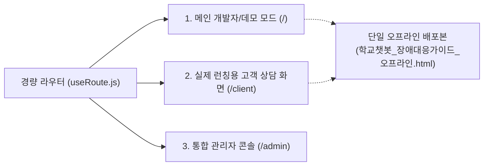

# 🎨 학교 유무선 장애상담 챗봇 - 프론트엔드 UI/UX 디자인 및 수정 협업 가이드

> **문서 버전**: v1.0.0  
> **최종 갱신일**: 2026-10-27  
> **대상 독자**: UI/UX 디자이너, 프론트엔드 퍼블리셔, 풀스택 개발자  
> **문서 목적**: 디자이너와 개발자가 본 가이드 **한 편만 확인하고도** 프로젝트의 디자인 시스템(색상·폰트·간격), 컴포넌트 파일 위치, 실시간 로컬 미리보기, 그리고 원클릭 빌드·배포까지 즉시 작업할 수 있도록 안내합니다.

---

## 📌 목차 (Table of Contents)
1. [시스템 아키텍처 및 3대 화면 구조](#1-시스템-아키텍처-및-3대-화면-구조)
2. [디자인 시스템 & CSS 토큰 명세 (CSS Variables)](#2-디자인-시스템--css-토큰-명세-css-variables)
3. [화면별 컴포넌트 및 스타일 파일 매핑 맵](#3-화면별-컴포넌트-및-스타일-파일-매핑-맵)
4. [핵심 UI 요소별 상세 수정 가이드](#4-핵심-ui-요소별-상세-수정-가이드)
   - 4.1. 상단 글로벌 헤더 (TopBar)
   - 4.2. 말풍선 & 메시지 렌더링 (Bot/User Message)
   - 4.3. 매뉴얼 증빙 형광펜 라이트박스 모달 (LightboxModal)
   - 4.4. 고객용 대화 히스토리 사이드바 (History Sidebar)
   - 4.5. 장애 증상 시나리오 버튼 스트립 (ScenarioStrip)
   - 4.6. 질의 입력창 & 전송 버튼 (ChatComposer)
   - 4.7. 관리자 콘솔 및 장애 상담 흐름 에디터 (Admin & Scenario Editor)
5. [자주 묻는 디자인 수정 레시피 (How-To Recipes)](#5-자주-묻는-디자인-수정-레시피-how-to-recipes)
6. [반응형 레이아웃 및 모바일 브레이크포인트](#6-반응형-레이아웃-및-모바일-브레이크포인트)
7. [로컬 실시간 개발 및 프리뷰 환경 실행법](#7-로컬-실시간-개발-및-프리뷰-환경-실행법)
8. [수정 완료 후 원클릭 빌드 & 배포 동기화 절차](#8-수정-완료-후-원클릭-빌드--배포-동기화-절차)
9. [협업 5대 핵심 준수 수칙](#9-협업-5대-핵심-준수-수칙)

---

## 1. 시스템 아키텍처 및 3대 화면 구조

본 프로젝트의 프론트엔드는 **React 19 + Vite 8** 기반의 모던 웹 애플리케이션으로, 복잡한 CSS 프레임워크(Tailwind 등) 없이 순수 **Vanilla CSS와 CSS Custom Properties(변수)** 기반으로 구축되어 있습니다.

브라우저 주소(URL)에 따라 아래 **3가지 독립된 전용 인터페이스**를 제공합니다:



| 화면 구분 | 접속 경로 (URL) | 주요 특징 및 대상 | 핵심 UI 구성 |
| :--- | :--- | :--- | :--- |
| **1. 메인 개발/데모** | `/` | 개발자·엔지니어 및 시연용 화면 | 좌측 대화창 + 우측 답변근거/인스펙터 2분할(Split) 화면 |
| **2. 고객용 상용 화면** | `/client` | 실제 학교 교직원 및 현장 사용자 화면 | 좌측 대화 히스토리 사이드바 + 중앙 와이드 대화창 |
| **3. 통합 관리자 콘솔** | `/admin` | 시스템 운영자 및 관리자 화면 | 6대 관리 탭(FAQ, RAG 문서, 시나리오 흐름, 웹검색, 대화이력, 설정) |
| **4. 오프라인 단일 배포본** | 프로젝트 루트 단일 파일 | 인터넷 단절(망분리) 환경 현장 PC용 | 외부 의존성 0% 자립형 640KB 단일 HTML 패키지 |

---

## 2. 디자인 시스템 & CSS 토큰 명세 (CSS Variables)

색상, 폰트, 여백, 곡률(radius), 그림자 등 모든 디자인 수치는 **CSS 변수**로 중앙 집중 관리됩니다.  
디자이너가 브랜드 테마 색상을 변경할 때는 **CSS 변수 값 하나만 수정하면 전체 UI에 즉각 일괄 반영**됩니다.

### 2.1. 메인 및 고객용 대화창 디자인 토큰 (`frontend/src/index.css`)

```css
/* 경로: chatbot_demo_v2/frontend/src/index.css */
:root {
  /* 🎨 배경 및 표면 (Surface) */
  --bg: #f8fafc;              /* 전체 배경색 (Slate-50) */
  --bg-subtle: #f1f5f9;       /* 연한 배경 / 카드 배경 (Slate-100) */
  --surface: #ffffff;         /* 메인 카드 및 말풍선 흰색 표면 */
  --surface-hover: #f8fafc;   /* 마우스 호버 시 표면색 */
  --border: #e2e8f0;          /* 기본 구분선 (Slate-200) */
  --border-strong: #cbd5e1;   /* 강조 구분선 (Slate-300) */
  --border-focus: #93c5fd;    /* 인풋 포커스 테두리 (Blue-300) */

  /* 🖋️ 타이포그래피 & 텍스트 */
  --text-main: #0f172a;       /* 본문 메인 텍스트 (Slate-900) */
  --text-sub: #475569;        /* 보조 텍스트 (Slate-600) */
  --text-muted: #64748b;      /* 비활성 / 캡션 텍스트 (Slate-500) */
  --text-light: #94a3b8;      /* 안내 플레이스홀더 텍스트 (Slate-400) */
  --font-sans: 'Pretendard', -apple-system, BlinkMacSystemFont, system-ui, sans-serif;

  /* 💎 브랜드 포인트 컬러 (Brand Colors) */
  --primary: #2563eb;         /* 메인 브랜드 블루 (Blue-600) */
  --primary-hover: #1d4ed8;   /* 브랜드 블루 호버 (Blue-700) */
  --primary-light: #eff6ff;   /* 브랜드 블루 연한 배경 (Blue-50) */
  --primary-border: #bfdbfe;  /* 브랜드 블루 테두리 (Blue-200) */
  --secondary: #0ea5e9;       /* 서브 스카이블루 (Sky-500) */
  --secondary-light: #f0f9ff; /* 서브 스카이블루 연한 배경 (Sky-50) */

  /* 🚦 상태 피드백 컬러 (Status) */
  --success: #10b981;         /* 정상 / 성공 녹색 (Emerald-500) */
  --success-bg: #ecfdf5;      /* 성공 연한 배경 */
  --warning: #f59e0b;         /* 주의 / 경고 황색 (Amber-500) */
  --warning-bg: #fffbeb;      /* 경고 연한 배경 */
  --danger: #ef4444;          /* 오류 / 삭제 적색 (Red-500) */
  --danger-bg: #fef2f2;       /* 오류 연한 배경 */

  /* 📐 곡률 (Border Radius) */
  --radius-sm: 6px;           /* 칩, 작은 버튼 */
  --radius-md: 10px;          /* 일반 버튼, 카드 */
  --radius-lg: 16px;          /* 말풍선, 팝업 */
  --radius-xl: 20px;          /* 대형 모달 컨테이너 */
  --radius-full: 9999px;      /* 원형 뱃지, 알약형 버튼 */

  /* 🌫️ 그림자 (Shadows) */
  --shadow-sm: 0 1px 2px 0 rgba(0, 0, 0, 0.05);
  --shadow-md: 0 4px 6px -1px rgba(0, 0, 0, 0.08), 0 2px 4px -2px rgba(0, 0, 0, 0.05);
  --shadow-lg: 0 10px 15px -3px rgba(0, 0, 0, 0.08), 0 4px 6px -4px rgba(0, 0, 0, 0.04);
  --shadow-xl: 0 20px 25px -5px rgba(0, 0, 0, 0.1), 0 8px 10px -6px rgba(0, 0, 0, 0.05);
}
```

### 2.2. 관리자 콘솔 전용 디자인 토큰 (`frontend/src/components/Admin/Admin.css`)

관리자 페이지는 데이터 시각화와 업무 편의를 위한 클린 라이트 대시보드 테마를 사용합니다:
* `--bg-main`: `#f8fafc` (배경에 은은한 3색 방사형 그라데이션 내장)
* `--bg-card`: `#ffffff`
* `--emerald`: `#059669` (정상 지표, 엑셀/문서 상태)
* `--purple`: `#7c3aed` (시나리오 노드 연결선 및 인터랙션)
* `--amber`: `#d97706` (주의/미매칭 상태)
* `--rose`: `#e11d48` (삭제, 연결 실패 상태)

---

## 3. 화면별 컴포넌트 및 스타일 파일 매핑 맵

디자이너가 특정 UI를 수정하고자 할 때 찾아가야 하는 파일 경로와 클래스 명세입니다.

```
📁 chatbot_demo_v2/frontend/src/
├── 📄 App.jsx                    # 루트 레이아웃 라우팅 및 모바일 드로어 제어
├── 📄 index.css                  # [전역] 메인·고객용 모든 디자인 스타일 (2,800+ lines)
├── 📄 App.css                    # 데스크톱 스플릿 레이아웃 및 브레이크포인트 보조
├── 📁 components/
│   ├── 📄 TopBar.jsx             # 상단 글로벌 헤더 (브랜드 로고, 서버상태 알약, 모드전환 버튼)
│   ├── 📄 ClientLayout.jsx       # 고객 전용 화면 (히스토리 사이드바 + 와이드 대화창)
│   ├── 📄 LightboxModal.jsx      # 매뉴얼 증빙 원본 + 형광펜 하이라이트 오버레이 모달
│   ├── 📁 Chat/                  # [대화 영역 핵심 컴포넌트]
│   │   ├── 📄 ChatColumn.jsx     # 대화 피드 컨테이너 및 헤더, 리셋 버튼
│   │   ├── 📄 BotMessage.jsx     # 챗봇 답변 말풍선, 근거 액션 바, 좋아요/싫어요 피드백
│   │   ├── 📄 AnswerRenderer.jsx # 답변 본문 마크다운, [p12] 인라인 인용 칩
│   │   ├── 📄 ChatComposer.jsx   # 하단 사용자 메시지 입력창 및 전송 버튼
│   │   ├── 📄 ScenarioStrip.jsx  # 하단 가로 스크롤 시나리오 추천 버튼 스트립
│   │   ├── 📄 ClarifyCard.jsx    # 모호 질문 발생 시 선택지 카드
│   │   └── 📄 BusyIndicator.jsx  # AI 답변 생성 중 진행률 애니메이션 & 경과시간 카운터
│   ├── 📁 Inspector/             # [데모 모드 전용 우측 분석 패널]
│   │   └── 📄 InspectorColumn.jsx# LangGraph 처리노드 경로, RAG 검색메타, 근거 이미지 그리드
│   └── 📁 Admin/                 # [통합 관리자 콘솔]
│       ├── 📄 AdminLayout.jsx    # 상단 6대 탭 내비게이션 및 서버 연결 상태바
│       ├── 📄 Admin.css          # 관리자 전용 대시보드 스타일 시트 (3,400+ lines)
│       ├── 📄 FaqTab.jsx         # FAQ 목록, 검색, 등록/수정 모달
│       ├── 📄 RagTab.jsx         # PDF 문서 업로드 및 5단계 실시간 재색인 터미널
│       ├── 📄 ScenarioTab.jsx    # 장애 상담 흐름 트리 관리 및 노드 등록/수정 모달
│       ├── 📄 ScenarioVisualTree.jsx # 캔버스 비주얼 노드 연결 인터랙티브 에디터
│       ├── 📄 WebSearchTab.jsx   # 실시간 구글 웹 검색 활성화 토글 및 예산 확인
│       ├── 📄 HistoryTab.jsx     # 대화 이력 감사, 세션 뷰, PII 비식별화 마스킹 검증
│       └── 📄 SettingsTab.jsx    # LLM 모델, API Key, L4 GPU 원격 서버 연동 설정
```

---

## 4. 핵심 UI 요소별 상세 수정 가이드

### 4.1. 상단 글로벌 헤더 (TopBar)
* **파일**: [`TopBar.jsx`](file:///c:/Users/ITZN/Desktop/챗봇/chatbot_demo_v2/frontend/src/components/TopBar.jsx), 스타일: `index.css`의 `.topbar`
* **주요 요소**:
  * 로고 & 타이틀: `.brand-section`, `.brand-title-text` (기본: `학교 유무선 장애상담 챗봇`)
  * 서버 연결 상태 알약: `.status-pill`, `.status-dot.ready` (정상 초록불), `.status-dot.error` (에러 빨간불)
  * 고객용/관리자 전환 버튼: `.client-link-btn`, `.admin-link-btn`
  * 모바일 근거보기 버튼: `.mobile-inspector-btn`

### 4.2. 말풍선 & 메시지 렌더링 (Bot/User Message)
* **파일**: [`BotMessage.jsx`](file:///c:/Users/ITZN/Desktop/챗봇/chatbot_demo_v2/frontend/src/components/Chat/BotMessage.jsx), [`AnswerRenderer.jsx`](file:///c:/Users/ITZN/Desktop/챗봇/chatbot_demo_v2/frontend/src/components/Chat/AnswerRenderer.jsx)
* **스타일 클래스**:
  * 사용자 말풍선: `.bubble-user`
    * 배경: `linear-gradient(135deg, var(--primary), #1d4ed8)`
    * 글자색: `#ffffff`, 곡률: `18px 18px 4px 18px`
  * 챗봇 말풍선: `.bubble-bot` / 고객용 `.client-bubble`
    * 배경: `var(--surface)`, 테두리: `1px solid var(--border)`, 곡률: `18px 18px 18px 4px`
  * 인라인 인용 칩: `.cite-chip`
    * 텍스트 내 `[p15]` 형태로 등장하며, 클릭 시 매뉴얼 15쪽 라이트박스가 즉시 열림
    * 형광펜 하이라이트가 포함된 경우 `.cite-chip.has-highlights` 클래스가 붙고 골드 반짝이 점(`.cite-highlight-dot`) 표시
  * 근거 액션 바: `.evidence-quick-bar` 및 `.btn-evidence-action`
    * 답변 하단에 첨부된 원본 매뉴얼 쪽수(예: `p.12 사용자 매뉴얼`)를 알약 버튼으로 시각화
  * 만족도 피드백: `.feedback-btn` (👍 / 👎 호버 애니메이션 및 전송 완료 배지)

### 4.3. 매뉴얼 증빙 형광펜 라이트박스 모달 (LightboxModal)
* **파일**: [`LightboxModal.jsx`](file:///c:/Users/ITZN/Desktop/챗봇/chatbot_demo_v2/frontend/src/components/LightboxModal.jsx)
* **동작 원리**:
  * 백엔드 AI가 찾아낸 정답 영역의 상대 좌표(`bbox: [x0, y0, x1, y1]`)를 백분율(`%`)로 계산하여 원본 이미지 위에 **노란색/파란색 형광펜 박스를 동적으로 오버레이**합니다.
* **스타일 클래스**:
  * 딤 오버레이: `.lightbox-backdrop` (`background: rgba(15, 23, 42, 0.75)`, 블러 효과)
  * 텍스트 형광펜 박스: `.lightbox-highlight-box.text-highlight`
    * 형광펜 배경: `rgba(250, 204, 21, 0.28)` (옐로우), 테두리: `2px solid #eab308`
  * 표(Table) 형광펜 박스: `.lightbox-highlight-box.table-highlight`
    * 형광펜 배경: `rgba(59, 130, 246, 0.22)` (블루), 테두리: `2px solid #3b82f6`

### 4.4. 고객용 대화 히스토리 사이드바 (History Sidebar)
* **파일**: [`ClientLayout.jsx`](file:///c:/Users/ITZN/Desktop/챗봇/chatbot_demo_v2/frontend/src/components/ClientLayout.jsx)
* **스타일 클래스**:
  * 사이드바 컨테이너: `.client-history-sidebar` (기본 너비: `280px`, 슬라이드 인/아웃 전환 지원)
  * 새 상담 시작 버튼: `.btn-new-chat-topbar`, `.btn-new-chat-sidebar`
  * 대화 세션 항목: `.history-session-item`, 선택된 상태: `.history-session-item.active`
  * 단건 삭제 버튼: `.btn-delete-session` (호버 시 표시)
  * 모바일 딤 백드롭: `.client-sidebar-backdrop`

### 4.5. 장애 증상 시나리오 버튼 스트립 (ScenarioStrip)
* **파일**: [`ScenarioStrip.jsx`](file:///c:/Users/ITZN/Desktop/챗봇/chatbot_demo_v2/frontend/src/components/Chat/ScenarioStrip.jsx)
* **스타일 클래스**:
  * 래퍼: `.scenario-strip` (가로 스크롤 및 그라디언트 페이드아웃 마스크)
  * 버튼: `.scenario-chip`
    * 배경: `var(--surface)`, 테두리: `1px solid var(--border-strong)`
    * 호버 효과: 테두리가 `var(--primary)`로 부드럽게 강조되며 미세하게 상단 부유(`transform: translateY(-1px)`)

### 4.6. 질의 입력창 & 전송 버튼 (ChatComposer)
* **파일**: [`ChatComposer.jsx`](file:///c:/Users/ITZN/Desktop/챗봇/chatbot_demo_v2/frontend/src/components/Chat/ChatComposer.jsx)
* **스타일 클래스**:
  * 컨테이너: `.chat-composer`
  * 텍스트 입력 영역: `.composer-input` (부드러운 포커스 아웃라인 링 탑재)
  * 전송 버튼: `.send-btn` (비활성 시 연한 회색, 입력 시 메인 블루 활성화, 로딩 시 회전 스피너 전환)

### 4.7. 관리자 콘솔 및 장애 상담 흐름 에디터 (Admin & Scenario Editor)
* **파일**: [`ScenarioTab.jsx`](file:///c:/Users/ITZN/Desktop/챗봇/chatbot_demo_v2/frontend/src/components/Admin/ScenarioTab.jsx), [`ScenarioVisualTree.jsx`](file:///c:/Users/ITZN/Desktop/챗봇/chatbot_demo_v2/frontend/src/components/Admin/ScenarioVisualTree.jsx)
* **스타일 클래스**:
  * 캔버스 뷰포트: `.scenario-canvas-container` (드래그 앤 줌 지원)
  * 최상위 질문 노드 카드: `.visual-node-card.root-card` (파란색 테두리 포인트)
  * 중간 안내/선택지 노드 카드: `.visual-node-card.question-card` (초록색 테두리 포인트)
  * 최종 해결 답변 노드 카드: `.visual-node-card.final-card` (보라색 테두리 포인트)
  * 노드 내 버튼 행: `.card-option-row` (라벨: `버튼 연결 항목:`)
  * 상위 질문 헤더 통합 모달: `.scenario-modal` (`새 하위 장애 상담 항목 추가: {상위질문}`)

---

## 5. 자주 묻는 디자인 수정 레시피 (How-To Recipes)

### 🍳 레시피 1: 메인 브랜드 컬러를 다른 색상(예: 인디고/그린)으로 바꾸고 싶어요
1. [`chatbot_demo_v2/frontend/src/index.css`](file:///c:/Users/ITZN/Desktop/챗봇/chatbot_demo_v2/frontend/src/index.css) 파일 열기.
2. 최상단 `:root`에서 `--primary` 및 `--primary-hover` 수정:
   ```css
   :root {
     --primary: #4f46e5;       /* 원하는 메인 컬러 HEX 코드 */
     --primary-hover: #4338ca; /* 마우스 호버 시 조금 더 어두운 톤 */
     --primary-light: #eef2ff; /* 버튼 배경용 연한 톤 */
     --primary-border: #c7d2fe;
   }
   ```
3. 저장 즉시 모든 버튼, 포커스 링, 링크, 사용자 말풍선에 자동 일괄 적용됩니다.

### 🍳 레시피 2: 말풍선 모서리를 덜 둥글게(혹은 더 둥글게) 하고 싶어요
1. [`chatbot_demo_v2/frontend/src/index.css`](file:///c:/Users/ITZN/Desktop/챗봇/chatbot_demo_v2/frontend/src/index.css) 파일 열기.
2. `.bubble-user` 및 `.bubble-bot` 검색:
   ```css
   .bubble-user {
     border-radius: 12px 12px 2px 12px; /* 기본 18px에서 원하는 곡률로 조정 */
   }
   .bubble-bot {
     border-radius: 12px 12px 12px 2px;
   }
   ```

### 🍳 레시피 3: 아이콘을 변경하거나 새 아이콘을 추가하고 싶어요
본 프로젝트는 글로벌 표준 아이콘 라이브러리인 **[Lucide React](https://lucide.dev/icons)**를 사용합니다.
1. [Lucide Icons 공식 사이트](https://lucide.dev/icons)에서 원하는 아이콘 이름 검색 (예: `Wrench`, `HelpCircle`, `Send` 등).
2. 해당 컴포넌트 JSX 상단에서 `import` 후 태그 형태로 삽입:
   ```jsx
   import { Wrench } from 'lucide-react';
   
   // 컴포넌트 내부에서 사용:
   <Wrench size={18} color="var(--primary)" />
   ```

### 🍳 레시피 4: 학교 로고나 이미지 배너를 교체하고 싶어요
* **정적 이미지 자산 위치**:
  * 번들링이 필요한 에셋: `chatbot_demo_v2/frontend/src/assets/`
  * 원본 그대로 서빙할 에셋(파비콘 등): `chatbot_demo_v2/frontend/public/`
* JSX에서 불러올 때:
  ```jsx
  import schoolLogo from '../assets/custom_logo.svg';
  
  
  ```

---

## 6. 반응형 레이아웃 및 모바일 브레이크포인트

모바일 스마트폰 및 태블릿 화면에서도 완벽하게 작동하도록 반응형 미디어 쿼리가 구성되어 있습니다:

| 기기 구분 | 뷰포트 너비 | 레이아웃 동작 방식 |
| :--- | :--- | :--- |
| **데스크톱 (Desktop)** | `1024px 이상` | • 좌측 대화창 + 우측 인스펙터 2분할(Split) 동시 노출<br>• 고객용 히스토리 사이드바 기본 오픈 |
| **태블릿 (Tablet)** | `768px ~ 1024px` | • 대화창 와이드 확보<br>• 히스토리 사이드바는 아이콘 토글형으로 전환 |
| **모바일 (Mobile)** | `768px 이하` | • 단일 열(Single Column) 대화 화면으로 집중<br>• 인스펙터 패널은 우측 '근거보기' 버튼 클릭 시 바닥에서 올라오는 **바텀 슬라이드 시트(Drawer)**로 변환<br>• 배경 딤(Dim Backdrop) 터치 시 닫힘 |

---

## 7. 로컬 실시간 개발 및 프리뷰 환경 실행법

디자이너가 코드를 수정하면서 브라우저에서 0.1초 만에 변경사항을 즉시 확인(Hot Module Replacement)할 수 있는 방법입니다.

### 7.1. 환경 준비 (최초 1회)
* Node.js (v18 이상 권장) 설치 여부 확인:
  ```bash
  node -v
  npm -v
  ```

### 7.2. 프론트엔드 실시간 개발 서버 기동
1. 터미널(PowerShell 또는 Bash)을 열고 프론트엔드 폴더로 이동:
   ```bash
   cd c:\Users\ITZN\Desktop\챗봇\chatbot_demo_v2\frontend
   ```
2. 패키지 설치 (최초 1회만 필요):
   ```bash
   npm install
   ```
3. 실시간 개발 서버 실행:
   ```bash
   npm run dev
   ```
4. 터미널에 표시되는 로컬 주소로 브라우저 접속:
   * **메인 데모 화면**: `http://localhost:5173/`
   * **고객용 상용 화면**: `http://localhost:5173/client`
   * **통합 관리자 콘솔**: `http://localhost:5173/admin`
5. 이제 CSS나 JSX 코드를 수정하고 저장(`Ctrl + S`)하면 **브라우저 새로고침 없이 화면이 실시간으로 갱신**됩니다.

---

## 8. 수정 완료 후 원클릭 빌드 & 배포 동기화 절차

디자인 수정이 완료되면, **일반 웹 서비스용 번들**과 **인터넷 단절망용 단일 오프라인 배포 파일**을 동시에 생성하여 동기화해야 합니다.

### 8.1. 원클릭 빌드 실행
터미널에서 프론트엔드 디렉터리로 이동 후 빌드 명령어를 실행합니다:
```bash
cd c:\Users\ITZN\Desktop\챗봇\chatbot_demo_v2\frontend
npm run build:all
```
* 이 명령어 하나로 다음 두 가지가 자동 생성됩니다:
  1. `dist/` : FastAPI 백엔드(`http://127.0.0.1:8002` 및 GCP 서버)에서 서빙할 웹 번들
  2. `dist-standalone/index.html` : 모든 자산(CSS, JS, SVG)이 인라인화된 독립 실행 파일

### 8.2. 오프라인 단일 배포본 파일 동기화
빌드된 단일 HTML을 프로젝트 최상위의 공식 배포 파일로 복사합니다:
```powershell
# PowerShell 기준 (chatbot_demo_v2/frontend 경로에서 실행)
Copy-Item -Path "dist-standalone\index.html" -Destination "..\..\학교챗봇_장애대응가이드_오프라인.html" -Force
```

### 8.3. GitHub 자동 커밋 및 서버 반영
루트 폴더(`c:\Users\ITZN\Desktop\챗봇`)에서 변경사항을 원격 저장소로 푸시합니다:
```bash
git add .
git commit -m "style: UI/UX 디자인 수정 및 최신 번들 빌드 반영"
git push origin main
```
> **서버 자동 반영**: GitHub `main`에 푸시되면, 원격 GCP L4 GPU 서버(`34.64.143.198`)에서 `~/update.sh` 한 줄로 0.5초 만에 상용 서버에 배포가 완료됩니다.

---

## 9. 협업 5대 핵심 준수 수칙

1. **🎨 인라인 스타일(`style={{ ... }}`) 직접 삽입 지양**
   * 컴포넌트 내부에 직접 인라인 스타일을 하드코딩하면 다크모드 대응이나 모바일 미디어 쿼리가 동작하지 않습니다. 항상 `index.css` 또는 `Admin.css`에 클래스를 정의하고 **CSS 변수를 활용**하세요.
2. **🚫 외부 무거운 라이브러리(Tailwind, Bootstrap 등) 임의 설치 금지**
   * 본 프로젝트는 초경량 640KB 단일 오프라인 자립 번들링을 최우선 목표로 설계되어 있습니다. 새로운 CSS 프레임워크를 추가하면 번들 크기가 비대해지므로 기존 CSS 변수 시스템을 준수해야 합니다.
3. **📦 빌드 시 `npm run build:all` 및 오프라인 파일 동기화 필수**
   * 웹 화면만 수정하고 오프라인 파일(`학교챗봇_장애대응가이드_오프라인.html`)을 갱신하지 않으면 망분리 현장 사용자와 버전 불일치가 발생합니다. 반드시 빌드 후 덮어쓰기를 완료하세요.
4. **👁️ 시인성 및 접근성(Contrast & Tooltip) 보장**
   * 글자색과 배경색의 명도 대비(Contrast Ratio)를 충분히 확보하고, 아이콘 버튼에는 반드시 `title` 및 `aria-label` 속성을 부여하여 툴팁과 스크린 리더를 지원하세요.
5. **📝 작업 후 인수인계 문서 기록 및 Git Push 필수 이행**
   * 디자인 수정이 완료되면 [`작업인수인계_및_진행현황.md`](file:///c:/Users/ITZN/Desktop/챗봇/작업인수인계_및_진행현황.md)에 수정 내역을 기록하고 GitHub에 커밋/푸시합니다.
