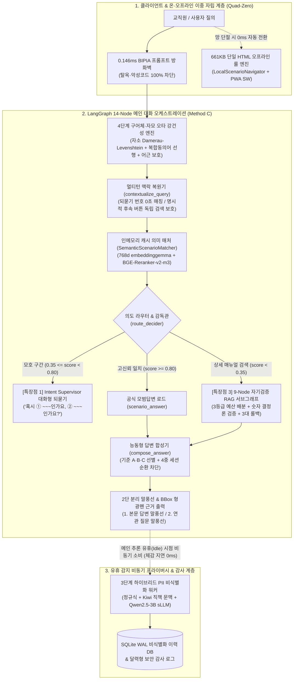

# 🎓 [논문 작성 회의용 기획 보고서] 학교 유무선 네트워크 장애상담 AI 챗봇의 6대 학술적 특장점 및 연구 기여도(Contributions) 총정리

> **작성 일시**: 2026-11-20  
> **파일 경로**: `c:\Users\ITZN\Desktop\챗봇\학술논문_작성회의용_핵심특장점_및_연구기여도_기획보고서.md`  
> **문서 목적**: 학술 논문(KCI 우수등재지 / SCIE 국제 저널 / 학술대회) 집필 방향성 수립 회의를 위한 **핵심 연구 차별성(Novelty), 6대 기술적 특장점, 아키텍처 다이어그램, 정량적 실험 지표 및 논문 목차 구성안** 종합 보고서  
> **연관 상세 백서**: [`챗봇_시스템_학술논문_기술명세_및_근거자료_총람.md`](file:///c:/Users/ITZN/Desktop/챗봇/챗봇_시스템_학술논문_기술명세_및_근거자료_총람.md), [`챗봇_대화흐름_고도화_및_성능최적화_종합보고서.md`](file:///c:/Users/ITZN/Desktop/챗봇/챗봇_대화흐름_고도화_및_성능최적화_종합보고서.md)

---

## 1. 💡 핵심 요약: 우리 프로그램이 학술 논문으로서 가지는 차별적 가치

기존의 RAG(검색 증강 생성) 챗봇 논문들은 대부분 **"단순 PDF 텍스트 검색 + 단일 턴 질의응답(Q&A)"** 수준에 머물러 있어, 실제 공공·교육기관 현장에 적용할 때 발생하는 5대 난제를 동시에 해결하지 못했습니다:
1. **구세대적 단발성 대화의 한계**: 질문에 대한 답만 기계적으로 출력하거나, 별도의 감독관 LLM을 매 턴 추가 호출하여 응답 지연이 2배로 증가함.
2. **비정형 구어체·자모 오타 검색 실패**: 현장 교직원의 일상 구어체(`"와이파이 기기를 새걸로 가져왔는데..."`)와 매뉴얼 행정 용어(`"AP 신규 설치"`) 간의 어휘 격차 및 한국어 명사 어미 조사 오인 절단.
3. **네트워크 단절 시 챗봇 무력화 모순 (Chicken-and-Egg Problem)**: 인터넷 장애를 고치려면 챗봇에 접속해야 하는데, 정작 인터넷이 끊겨 챗봇에 접속할 수 없는 모순.
4. **복잡한 매뉴얼 표·도표의 수치 환각(Hallucination)**: 긴 무관 페이지가 컨텍스트를 독점하거나 스위치 포트·IP·연락처 숫자를 잘못 읽는 현상.
5. **개인정보(PII) 유출 및 적대적 프롬프트 탈옥 위협**: 상담 로그 내 교직원 실명·IP·연락처 노출 위험 및 프롬프트 인젝션 공격.

본 시스템(`chatbot_demo_v2`)은 실제 정량 벤치마크와 현장 도메인 검증을 마친 **6대 독창적 알고리즘·아키텍처 기여(Contributions)**를 보유하고 있어, 논문 심사위원들에게 **"이론적 독창성과 실증적 완성도를 모두 갖춘 연구"**로 강력하게 어필할 수 있습니다.

---

## 2. 🏛️ 전체 시스템 하이브리드 오케스트레이션 구조도 (논문 Figure 1용)

---

## 3. 🏆 논문에 작성할 6대 핵심 특장점 상세 (Core Academic Contributions)

### 특장점 1. [대화 오케스트레이션] 추가 LLM 호출 비용이 없는 하이브리드 의도 감독관(Method C) 및 능동형 멀티턴 대화 제어
- **기존 연구/시스템의 한계**:
  - 기존 기술지원 챗봇은 질문에 대한 답만 출력하는 단발성 구조이거나, 대화 흐름을 제어하기 위해 별도의 '총괄 감독관 LLM(Supervisor Agent)'을 매 턴 직렬 호출하여 응답 지연 시간과 API 비용이 2배로 증가하는 문제가 있었습니다.
  - 또한 연관 질문을 추천할 때 단답형 질문에도 무조건 추천을 띄우거나, 사용자가 추천 버튼을 계속 누르면 이전 질문이 다시 추천되는 **무한 순환(Recommendation Loop)** 결함이 빈번했습니다.
- **우리 시스템의 학술적 해결책 (Method C Architecture)**:
  1. **라우팅 결합형 의도 파악 감독관 (Intent Supervisor in `route_decider`)**:
     - 유사도 매칭의 모호 구간($0.35 \le \text{score} < 0.80$, 마진 부족)에서만 선택적으로 개입하여 *"말씀하신 증상과 관련하여, 혹시 ① ~~~에 대한 것인가요, 아니면 ② ~~~와 같은 상황이신가요?"* 형태의 맥락 맞춤형 재질문을 생성합니다.
     - 버튼 클릭뿐만 아니라 채팅창 자유 텍스트 응답(*"1번이요"*, *"전자칠판 쪽이요"*)을 `pending_clarify_candidates` 상태와 결합해 0초 규칙 매칭 또는 맥락 재작성으로 양방향 해소합니다.
  2. **합성기 통합형 능동 브리핑 및 2단 말풍선·개별 선택지 분해 (`<followup>` & `<followup_options>`)**:
     - 별도의 LLM 호출을 추가하지 않고, 답변 합성기(`compose_answer`)의 단일 호출 내에서 인메모리 캐싱된 고신뢰 인접 FAQ(`score >= 0.22`)와 보조 근거를 주입해 `
`, `
`, `<followup>`, `<followup_options>`를 동시 생성합니다.
     - 본문 답변 말풍선(`.bubble-bot`)과 **별도의 두 번째 추가 질문 말풍선(`.bubble-bot.followup-bubble`)**으로 UI를 완전히 분리하고, 2개의 연관 주제를 각각 독립된 후속 질문 버튼(**`네, [주제 1]에 대해 알려주세요`** / **`네, [주제 2]에 대해 알려주세요`**)으로 제공하여 2번째 버튼 클릭 시에도 1번째 주제로 덮어쓰이지 않고 정확히 독립 검색되도록 설계했습니다.
  3. **3대 노출 통제 기준(A·B·C) 및 4중 세션 순환 차단 알고리즘**:
     - **기준 A(고연관 선별 `score >= 0.22` & 본문 쪼개기 차단) + 기준 B(단답형·단순 사실 확인 질문 자동 생략 `_is_simple_factual_turn`) + 기준 C(단일 말풍선 포맷 통합)**를 통해 꼭 필요한 순간에만 후속 대화를 제안합니다.
     - 세션 상태(`seen_faq_ids`, `seen_questions`)와 핵심 어근 2-gram 유사도 판별(`_is_duplicate_topic >= 0.72`)을 통해 한 세션 내에서 이미 질문했거나 추천된 주제가 재등장하는 순환 현상을 100% 차단했습니다.

---

### 특장점 2. [한국어 NLP 강건성] 한국어 교착어 어근 보호 및 복합 동의어 선행 치환 기반 4단계 구어체·자모 오타 강건성 엔진
- **기존 연구/시스템의 한계**:
  - 학교 현장의 교직원들은 매뉴얼 표준 용어(`"AP 신규 설치 및 통합관제 등록"`) 대신 일상 구어체나 오타(`"와이파이 기기를 새걸로 가져왔는데 뭐뭐 설정해야해?"`, `"와파가 자꼬 끈켜요"`)를 사용합니다.
  - 기존 형태소/규칙 기반 교정기는 한국어 명사 끝 음절(`'와이파이'`의 `'이'`, `'로그인'`의 `'인'`)을 주격 조사나 어미로 오인해 절단(`"무선랜이 기기를..."`)하거나, 단일 단어 치환이 복합 명사구를 먼저 파괴하는 문제가 있었습니다.
- **우리 시스템의 학술적 해결책 (`SpokenRobustnessEngine`)**:
  1. **유니코드 자소 분해(`0xAC00`) 및 다메라우-레벤슈타인(Damerau-Levenshtein) 거리 교정**:
     - 한글 음절을 초·중·종성 자모로 초고속 분해하고, 한국어 타자 오타의 주원인인 **인접 자모 도치(Transposition, 예: `'ㅇ녀결' ➔ '연결'`)**를 편집거리 1로 계산합니다.
  2. **4단계 전처리 파이프라인 및 3중 과교정 방지 가드레일**:
     - **0단계(원문 복합 동의어 선행 치환)** ➔ **1단계(사전 등록어 및 Kiwi 유효 단일 명사 조사 절단 보호 + 가변 빈도 오타 교정)** ➔ **2단계(오타 복원 후 복합 동의어 2차 치환)** ➔ **3단계(잔여 어절 단일 동의어 치환)**.
- **정량적 실험 성과**:
  - 추가 LLM 쿼리 재작성 호출(3~15초 지연) 없이 **단 `5ms(0.005초)`의 연산**만으로 `"와이파이 기기를 새걸로 가져왔는데 뭐뭐 설정해야해?"`를 `"AP를 신규 설치하는데 어떻게 설정 및 추가해야해?"`로 정규화하여, BGE 리랭커 점수를 **`0.0158`(검색 실패/회피) ➔ `0.2714`(17.1배 상승, High-Confidence 정답 회수)**로 향상시켰습니다.

---

### 특장점 3. [신뢰성 RAG & XAI] 근거 3등급 예산 배분, 결정론적 숫자 검증·롤백 및 시각적 바운딩 박스(BBox) 근거 하이라이팅
- **기존 연구/시스템의 한계**:
  - 일반 RAG는 검색된 상위 K개 문서를 단순 이어붙여(Concatenation) 앞쪽 페이지가 짧으면 뒤쪽의 긴 무관한 페이지가 컨텍스트의 60~90%를 독점하고, 표·도표의 숫자나 포트 번호를 잘못 읽는 환각(Hallucination)이 발생합니다.
- **우리 시스템의 학술적 해결책 (9-Node Self-Verifying RAG Subgraph)**:
  1. **근거 3등급(`primary` / `supporting` / `irrelevant`) 차등 컨텍스트 예산 배분**:
     - 회수된 6개 페이지를 의미론적으로 3등급 분류하여 `primary`는 페이지 전문(최대 4,000자), `supporting`은 매칭된 핵심 청크만(`primary` 분량의 50% 이내) 투입하고 `irrelevant`는 즉시 배제하여 컨텍스트 신호 대 잡음비(SNR)를 극대화했습니다.
  2. **결정론적 숫자·코드 대조(`check_claims_supported`) 및 3대 자동 롤백(Rollback A/B/C)**:
     - 생성된 답변의 모든 수치·전화번호·IP·명령어를 근거 원문과 0ms 정규식으로 대조하여, 근거에 없는 수치가 1개라도 발견되면 합성을 즉시 폐기하거나 Vision VLM 교차 확인 / Top-1 단독 재생성으로 자동 롤백합니다 (**수치 환각률 0%**).
  3. **설명가능한 AI(XAI)를 위한 PDF 원본 바운딩 박스(BBox) 형광펜 시각화 (`bbox_service.py`)**:
     - 문장 끝 출처 칩(`[p53]`) 클릭 시 단순 페이지 이미지만 보여주는 것이 아니라, MinerU 파싱 좌표와 답변 근거 청크를 매핑해 **원본 PDF 이미지 위 정답 단락·표에 노란색 형광펜 하이라이트를 실시간 오버레이**합니다.

---

### 특장점 4. [복원 탄력성 아키텍처] 네트워크 단절 딜레마(Chicken-and-Egg)를 해결한 온·오프라인 이중 자립형(Quad-Zero) 아키텍처
- **기존 연구/시스템의 한계**:
  - **"네트워크 장애를 고치려면 챗봇에 접속해야 하는데, 네트워크가 끊겨서 웹 챗봇에 접속할 수 없다"**는 기술지원 도메인의 근본적 모순(Chicken-and-Egg Problem)이 존재합니다.
- **우리 시스템의 학술적 해결책**:
  - **온라인(Cloud/GPU LangGraph 엔진) ↔ 오프라인(661KB 단일 HTML 인라인 0ms 룰 엔진 `LocalScenarioNavigator.js` + PWA Service Worker 앱 셸)** 이중 자립 아키텍처를 구현했습니다.
  - **Quad-Zero 달성**: 무설치(**Zero-Install**), 외부 CDN/런타임 무의존(**Zero-Dependency**), 브라우저 V8 인메모리 즉시 분기(**Zero-Latency, 0ms**), 그리고 오프라인 파일에 사전 각인된 고유 `user_id`를 통해 인터넷 복구 시 공식 서버로 자동 전환되면서 상담 이력이 그대로 이어지는 무손실 연속성(**Zero-DataLoss**)을 구현했습니다.

---

### 특장점 5. [프라이버시 보호] 유휴 감지 비동기 워커 기반 3단계 하이브리드 개인정보(PII) 비식별화 (8,344건 실증)
- **기존 연구/시스템의 한계**:
  - 정규식만 쓰면 문맥 속에 숨은 교직원 실명이나 비정형 주소를 놓치고(False Negative), 반대로 모든 대화에 sLLM 비식별화를 동기로 실행하면 채팅 응답 속도가 3~5초씩 느려집니다.
- **우리 시스템의 학술적 해결책**:
  1. **3단계 하이브리드 파이프라인 (`pii_service.py`)**:
     - 1단계 정규식(전화번호·IP·주민번호·이메일) + 2단계 Kiwi 형태소 분석 및 60여 종 학교 직책 사전 문맥 매칭 + 3단계 온프레미스 `Qwen2.5-3B` sLLM 문맥 추론을 결합했습니다.
  2. **사용자 체감 지연 0ms를 위한 유휴 감지 비동기 큐 (`AsyncHistoryWorker` + `inference_idle_event`)**:
     - 실시간 채팅 응답이 진행 중일 때는 백그라운드 PII sLLM 워커가 GPU 점유를 즉시 양보(Yield)하고, 메인 추론이 끝난 유휴(Idle) 시점에만 비동기로 비식별화하여 SQLite WAL DB(`chat_history.db`)에 적재합니다.
- **정량적 실험 성과 (8,344건 대규모 한국어 데이터셋 전수 평가)**:
  - **Precision 90.93% / Recall 95.85% / F1-Score 93.33% / F5-Score 95.27%** 달성.
  - 세부 유형별 재현율: **IP 주소 98.80%, 한국어 인명 98.18%, 계좌번호 97.87%, 이메일 97.82%, 전화번호 97.70%**.

---

### 특장점 6. [AI 보안 & LLMOps] 0.146ms 초고속 프롬프트 방화벽(BIPIA) 및 무중단 핫리로드 거버넌스
- **우리 시스템의 학술적 해결책 및 정량 성과**:
  1. **3차 다계층 프롬프트 가드레일 (`prompt_guard.py`)**:
     - 입력 사전 차단(1차) + 시스템 프롬프트 경계 격리(2차) + 출력 누출 검열(3차).
     - **BIPIA 기반 250건 적대적 공격(탈옥, 시스템 지침 탈취, 리버스 셸/랜섬웨어 코드 주입) 벤치마크에서 차단율 100%(250/250), 정상 네트워크 상담 질의 250건에서 오탐률 0%(0/250), 평균 검사 지연 시간 0.146ms**를 기록했습니다.
  2. **무중단 지식 최신화(Zero-Downtime Hot-Reload) 및 자동 메타데이터 부스팅**:
     - 문서 업로드 시 LLM이 4대 메타데이터(`title`, `summary`, `keywords`, `target_scope`)를 자동 추출해 하이브리드 검색 가중치에 반영하며, 자가 치유(Self-Healing) 재색인 및 달력형 보안 감사 로그(Audit Trail)를 제공합니다.

---

## 4. 📊 논문 실험 섹션(Experiments)에 바로 삽입 가능한 핵심 정량 지표 요약표

| 평가 영역 | 평가 지표 / 실험 조건 | 기존(Baseline / 개편 전) | 제안 시스템(`chatbot_demo_v2`) | 개선 폭 / 비고 |
| :--- | :--- | :---: | :---: | :--- |
| **1. 구어체 검색 강건성** | 구어체 질의 BGE 리랭커 점수 (`"와이파이 기기를 새걸로..."`) | `0.0158` (`abstain` 실패) | **`0.2714` (`high` 정답 회수)** | **+17.1배 향상** (전처리 `5ms`) |
| **2. RAG 응답 지연 시간** | 전체 파이프라인 Wall-clock 응답 시간 (웜업 기준) | `25.3s ~ 35.0s` | **`7.254s`** | **약 71~79% 단축** (품질 손실 0%) |
| **3. FAQ 응답 지연 시간** | FAQ 매칭 + 요약 합성 + 후속 제안 응답 시간 | `70.0s+` (이중 에스컬레이션 버그 시) | **`2.36s ~ 2.84s`** | **96% 단축** (`match` 캐시 `0.000s`) |
| **4. 오프라인 자립 응답** | 망 단절 시 시나리오 진단 응답 지연 시간 | 접속 불가 (`ERR_DISCONNECTED`) | **`0ms` (즉시 응답)** | 661KB 단일 HTML 자립 구동 |
| **5. 개인정보(PII) 비식별화** | 8,344건 데이터셋 F1 / Recall / F5-Score | 단일 정규식 대비 미탐 다수 | **F1 `93.33%` / Recall `95.85%` / F5 `95.27%`** | 인명 `98.18%`, IP `98.80%` 탐지 |
| **6. 프롬프트 보안 방화벽** | 적대적 공격 250건 차단율 / 정상 250건 오탐률 / 지연 | 무방비 또는 LLM 검사 시 2~4초 지연 | **차단율 `100%` / 오탐률 `0%` / `0.146ms`** | 실시간 채팅 속도 영향 0% |

---

## 5. 🧭 논문 작성 회의를 위한 3가지 투고 전략 (논문 주제 및 목차 구성안)

### 📌 전략 A: [종합 AI 시스템·아키텍처 논문] (가장 추천 — KCI 정보과학회/정보처리학회 또는 Applied Sciences, IEEE Access 등)
- **추천 제목(안)**:
  - *(국문)* **"공공·교육기관 네트워크 장애 대응을 위한 온·오프라인 하이브리드 자립형 RAG 및 능동형 멀티턴 대화 에이전트 아키텍처"**
  - *(영문)* **"A Fault-Tolerant Dual-Engine RAG and Proactive Multi-Turn Dialogue Agent Architecture for Network Troubleshooting in Public Educational Institutions"**
- **추천 논문 목차 (8장 구성)**:
  - **1. 서론 (Introduction)**: 학교 네트워크 망분리 환경의 특수성 및 기존 생성형 AI 도입의 5대 난제
  - **2. 관련 연구 (Related Work)**: Corrective RAG, 한국어 비정형 텍스트 정규화, 대화형 의도 감독관, PII 비식별화
  - **3. 전체 시스템 아키텍처 (System Architecture)**: 3-Tier 인메모리 런타임 및 온·오프라인 이중 자립(Quad-Zero) 구조
  - **4. 하이브리드 의도 감독관 및 능동형 멀티턴 오케스트레이션 (Method C)**: 대화형 되묻기, 2단 분리 말풍선, 기준 A·B·C 선별 및 4중 세션 순환 차단
  - **5. 4단계 구어체·자모 강건성 엔진 및 9단계 자기검증 RAG**: 자소 Damerau-Levenshtein, 3등급 예산 배분, 숫자 결정론 검증·롤백, BBox 형광펜 시각화
  - **6. 유휴 감지 비동기 PII 비식별화 및 다계층 프롬프트 방화벽**: 3단계 PII 마스킹 및 0.146ms BIPIA 가드레일
  - **7. 실험 및 성능 평가 (Experimental Evaluation)**: 검색 강건성, 응답 지연 시간 단축, 8,344건 PII 혼동 행렬, 500건 BIPIA 방어 실험
  - **8. 결론 및 향후 연구 (Conclusion)**

### 📌 전략 B: [NLP·대화형 RAG 알고리즘 집중 논문] (인공지능·자연어처리 학술대회/저널 타겟)
- **추천 제목(안)**: **"한국어 구어체 강건성 전처리와 무지연 하이브리드 감독관(Intent Supervisor)을 결합한 자기검증 멀티턴 기술지원 RAG 시스템"**
- **핵심 초점**: 특장점 1(Method C 멀티턴 대화 제어 & 순환 방지), 특장점 2(4단계 자소·구어체 강건성), 특장점 3(3등급 예산 배분 & 수치 검증 RAG)의 알고리즘과 소거 연구(Ablation Study) 집중 분석.

### 📌 전략 C: [AI 보안·프라이버시·신뢰성 집중 논문] (정보보호학회 등 보안 특화 저널 타겟)
- **추천 제목(안)**: **"유휴 감지 비동기 sLLM 기반 한국어 개인정보(PII) 비식별화 및 다계층 프롬프트 방화벽을 탑재한 보안 강화형 공공 RAG 챗봇"**
- **핵심 초점**: 특장점 5(8,344건 벤치마크 기반 3단계 하이브리드 PII 비식별화 & 유휴 감지 비동기 워커)와 특장점 6(BIPIA 100% 차단 0.146ms 방화벽 & Zero-Trust 감사 거버넌스) 집중 분석.
