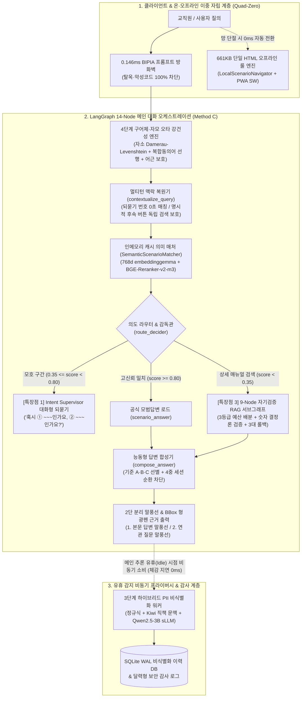

# 🎓 [논문 작성 회의용 기획 보고서] 학교 유무선 네트워크 장애상담 AI 챗봇의 6대 학술적 특장점 및 연구 기여도(Contributions) 총정리

> **작성 일시**: 2026-11-20  
> **파일 경로**: `c:\Users\ITZN\Desktop\챗봇\학술논문_작성회의용_핵심특장점_및_연구기여도_기획보고서.md`  
> **문서 목적**: 학술 논문(KCI 우수등재지 / SCIE 국제 저널 / 학술대회) 집필 방향성 수립 회의를 위한 **핵심 연구 차별성(Novelty), 6대 기술적 특장점, 아키텍처 다이어그램, 정량적 실험 지표 및 논문 목차 구성안** 종합 보고서  
> **연관 상세 백서**: [`챗봇_시스템_학술논문_기술명세_및_근거자료_총람.md`](file:///c:/Users/ITZN/Desktop/챗봇/챗봇_시스템_학술논문_기술명세_및_근거자료_총람.md), [`챗봇_대화흐름_고도화_및_성능최적화_종합보고서.md`](file:///c:/Users/ITZN/Desktop/챗봇/챗봇_대화흐름_고도화_및_성능최적화_종합보고서.md)

---

## 1. 💡 핵심 요약: 우리 프로그램이 학술 논문으로서 가지는 차별적 가치

기존의 RAG(검색 증강 생성) 챗봇 논문들은 대부분 **"단순 PDF 텍스트 검색 + 단일 턴 질의응답(Q&A)"** 수준에 머물러 있어, 실제 공공·교육기관 현장에 적용할 때 발생하는 5대 난제를 동시에 해결하지 못했습니다:
1. **구세대적 단발성 대화의 한계**: 질문에 대한 답만 기계적으로 출력하거나, 별도의 감독관 LLM을 매 턴 추가 호출하여 응답 지연이 2배로 증가함.
2. **비정형 구어체·자모 오타 검색 실패**: 현장 교직원의 일상 구어체(`"와이파이 기기를 새걸로 가져왔는데..."`)와 매뉴얼 행정 용어(`"AP 신규 설치"`) 간의 어휘 격차 및 한국어 명사 어미 조사 오인 절단.
3. **네트워크 단절 시 챗봇 무력화 모순 (Chicken-and-Egg Problem)**: 인터넷 장애를 고치려면 챗봇에 접속해야 하는데, 정작 인터넷이 끊겨 챗봇에 접속할 수 없는 모순.
4. **복잡한 매뉴얼 표·도표의 수치 환각(Hallucination)**: 긴 무관 페이지가 컨텍스트를 독점하거나 스위치 포트·IP·연락처 숫자를 잘못 읽는 현상.
5. **개인정보(PII) 유출 및 적대적 프롬프트 탈옥 위협**: 상담 로그 내 교직원 실명·IP·연락처 노출 위험 및 프롬프트 인젝션 공격.

본 시스템(`chatbot_demo_v2`)은 실제 정량 벤치마크와 현장 도메인 검증을 마친 **6대 독창적 알고리즘·아키텍처 기여(Contributions)**를 보유하고 있어, 논문 심사위원들에게 **"이론적 독창성과 실증적 완성도를 모두 갖춘 연구"**로 강력하게 어필할 수 있습니다.

---

## 2. 🏛️ 전체 시스템 하이브리드 오케스트레이션 구조도 (논문 Figure 1용)



---

## 3. 🏆 논문에 작성할 6대 핵심 특장점 상세 (Core Academic Contributions)

### 특장점 1. [대화 오케스트레이션] 추가 LLM 호출 비용이 없는 하이브리드 의도 감독관(Method C) 및 능동형 멀티턴 대화 제어
- **기존 연구/시스템의 한계**:
  - 기존 기술지원 챗봇은 질문에 대한 답만 출력하는 단발성 구조이거나, 대화 흐름을 제어하기 위해 별도의 '총괄 감독관 LLM(Supervisor Agent)'을 매 턴 직렬 호출하여 응답 지연 시간과 API 비용이 2배로 증가하는 문제가 있었습니다.
  - 또한 연관 질문을 추천할 때 단답형 질문에도 무조건 추천을 띄우거나, 사용자가 추천 버튼을 계속 누르면 이전 질문이 다시 추천되는 **무한 순환(Recommendation Loop)** 결함이 빈번했습니다.
- **우리 시스템의 학술적 해결책 (Method C Architecture)**:
  1. **라우팅 결합형 의도 파악 감독관 (Intent Supervisor in `route_decider`)**:
     - 유사도 매칭의 모호 구간($0.35 \le \text{score} < 0.80$, 마진 부족)에서만 선택적으로 개입하여 *"말씀하신 증상과 관련하여, 혹시 ① ~~~에 대한 것인가요, 아니면 ② ~~~와 같은 상황이신가요?"* 형태의 맥락 맞춤형 재질문을 생성합니다.
     - 버튼 클릭뿐만 아니라 채팅창 자유 텍스트 응답(*"1번이요"*, *"전자칠판 쪽이요"*)을 `pending_clarify_candidates` 상태와 결합해 0초 규칙 매칭 또는 맥락 재작성으로 양방향 해소합니다.
  2. **합성기 통합형 능동 브리핑 및 2단 말풍선·개별 선택지 분해 (`<followup>` & `<followup_options>`)**:
     - 별도의 LLM 호출을 추가하지 않고, 답변 합성기(`compose_answer`)의 단일 호출 내에서 인메모리 캐싱된 고신뢰 인접 FAQ(`score >= 0.22`)와 보조 근거를 주입해 `<summary>`, `<details>`, `<followup>`, `<followup_options>`를 동시 생성합니다.
     - 본문 답변 말풍선(`.bubble-bot`)과 **별도의 두 번째 추가 질문 말풍선(`.bubble-bot.followup-bubble`)**으로 UI를 완전히 분리하고, 2개의 연관 주제를 각각 독립된 후속 질문 버튼(**`네, [주제 1]에 대해 알려주세요`** / **`네, [주제 2]에 대해 알려주세요`**)으로 제공하여 2번째 버튼 클릭 시에도 1번째 주제로 덮어쓰이지 않고 정확히 독립 검색되도록 설계했습니다.
  3. **3대 노출 통제 기준(A·B·C) 및 4중 세션 순환 차단 알고리즘**:
     - **기준 A(고연관 선별 `score >= 0.22` & 본문 쪼개기 차단) + 기준 B(단답형·단순 사실 확인 질문 자동 생략 `_is_simple_factual_turn`) + 기준 C(단일 말풍선 포맷 통합)**를 통해 꼭 필요한 순간에만 후속 대화를 제안합니다.
     - 세션 상태(`seen_faq_ids`, `seen_questions`)와 핵심 어근 2-gram 유사도 판별(`_is_duplicate_topic >= 0.72`)을 통해 한 세션 내에서 이미 질문했거나 추천된 주제가 재등장하는 순환 현상을 100% 차단했습니다.

---

### 특장점 2. [한국어 NLP 강건성] 한국어 교착어 어근 보호 및 복합 동의어 선행 치환 기반 4단계 구어체·자모 오타 강건성 엔진
- **기존 연구/시스템의 한계**:
  - 학교 현장의 교직원들은 매뉴얼 표준 용어(`"AP 신규 설치 및 통합관제 등록"`) 대신 일상 구어체나 오타(`"와이파이 기기를 새걸로 가져왔는데 뭐뭐 설정해야해?"`, `"와파가 자꼬 끈켜요"`)를 사용합니다.
  - 기존 형태소/규칙 기반 교정기는 한국어 명사 끝 음절(`'와이파이'`의 `'이'`, `'로그인'`의 `'인'`)을 주격 조사나 어미로 오인해 절단(`"무선랜이 기기를..."`)하거나, 단일 단어 치환이 복합 명사구를 먼저 파괴하는 문제가 있었습니다.
- **우리 시스템의 학술적 해결책 (`SpokenRobustnessEngine`)**:
  1. **유니코드 자소 분해(`0xAC00`) 및 다메라우-레벤슈타인(Damerau-Levenshtein) 거리 교정**:
     - 한글 음절을 초·중·종성 자모로 초고속 분해하고, 한국어 타자 오타의 주원인인 **인접 자모 도치(Transposition, 예: `'ㅇ녀결' ➔ '연결'`)**를 편집거리 1로 계산합니다.
  2. **4단계 전처리 파이프라인 및 3중 과교정 방지 가드레일**:
     - **0단계(원문 복합 동의어 선행 치환)** ➔ **1단계(사전 등록어 및 Kiwi 유효 단일 명사 조사 절단 보호 + 가변 빈도 오타 교정)** ➔ **2단계(오타 복원 후 복합 동의어 2차 치환)** ➔ **3단계(잔여 어절 단일 동의어 치환)**.
- **정량적 실험 성과**:
  - 추가 LLM 쿼리 재작성 호출(3~15초 지연) 없이 **단 `5ms(0.005초)`의 연산**만으로 `"와이파이 기기를 새걸로 가져왔는데 뭐뭐 설정해야해?"`를 `"AP를 신규 설치하는데 어떻게 설정 및 추가해야해?"`로 정규화하여, BGE 리랭커 점수를 **`0.0158`(검색 실패/회피) ➔ `0.2714`(17.1배 상승, High-Confidence 정답 회수)**로 향상시켰습니다.

---

### 특장점 3. [신뢰성 RAG & XAI] 근거 3등급 예산 배분, 결정론적 숫자 검증·롤백 및 시각적 바운딩 박스(BBox) 근거 하이라이팅
- **기존 연구/시스템의 한계**:
  - 일반 RAG는 검색된 상위 K개 문서를 단순 이어붙여(Concatenation) 앞쪽 페이지가 짧으면 뒤쪽의 긴 무관한 페이지가 컨텍스트의 60~90%를 독점하고, 표·도표의 숫자나 포트 번호를 잘못 읽는 환각(Hallucination)이 발생합니다.
- **우리 시스템의 학술적 해결책 (9-Node Self-Verifying RAG Subgraph)**:
  1. **근거 3등급(`primary` / `supporting` / `irrelevant`) 차등 컨텍스트 예산 배분**:
     - 회수된 6개 페이지를 의미론적으로 3등급 분류하여 `primary`는 페이지 전문(최대 4,000자), `supporting`은 매칭된 핵심 청크만(`primary` 분량의 50% 이내) 투입하고 `irrelevant`는 즉시 배제하여 컨텍스트 신호 대 잡음비(SNR)를 극대화했습니다.
  2. **결정론적 숫자·코드 대조(`check_claims_supported`) 및 3대 자동 롤백(Rollback A/B/C)**:
     - 생성된 답변의 모든 수치·전화번호·IP·명령어를 근거 원문과 0ms 정규식으로 대조하여, 근거에 없는 수치가 1개라도 발견되면 합성을 즉시 폐기하거나 Vision VLM 교차 확인 / Top-1 단독 재생성으로 자동 롤백합니다 (**수치 환각률 0%**).
  3. **설명가능한 AI(XAI)를 위한 PDF 원본 바운딩 박스(BBox) 형광펜 시각화 (`bbox_service.py`)**:
     - 문장 끝 출처 칩(`[p53]`) 클릭 시 단순 페이지 이미지만 보여주는 것이 아니라, MinerU 파싱 좌표와 답변 근거 청크를 매핑해 **원본 PDF 이미지 위 정답 단락·표에 노란색 형광펜 하이라이트를 실시간 오버레이**합니다.

---

### 특장점 4. [복원 탄력성 아키텍처] 네트워크 단절 딜레마(Chicken-and-Egg)를 해결한 온·오프라인 이중 자립형(Quad-Zero) 아키텍처
- **기존 연구/시스템의 한계**:
  - **"네트워크 장애를 고치려면 챗봇에 접속해야 하는데, 네트워크가 끊겨서 웹 챗봇에 접속할 수 없다"**는 기술지원 도메인의 근본적 모순(Chicken-and-Egg Problem)이 존재합니다.
- **우리 시스템의 학술적 해결책**:
  - **온라인(Cloud/GPU LangGraph 엔진) ↔ 오프라인(661KB 단일 HTML 인라인 0ms 룰 엔진 `LocalScenarioNavigator.js` + PWA Service Worker 앱 셸)** 이중 자립 아키텍처를 구현했습니다.
  - **Quad-Zero 달성**: 무설치(**Zero-Install**), 외부 CDN/런타임 무의존(**Zero-Dependency**), 브라우저 V8 인메모리 즉시 분기(**Zero-Latency, 0ms**), 그리고 오프라인 파일에 사전 각인된 고유 `user_id`를 통해 인터넷 복구 시 공식 서버로 자동 전환되면서 상담 이력이 그대로 이어지는 무손실 연속성(**Zero-DataLoss**)을 구현했습니다.

---

### 특장점 5. [프라이버시 보호] 유휴 감지 비동기 워커 기반 3단계 하이브리드 개인정보(PII) 비식별화 (8,344건 실증)
- **기존 연구/시스템의 한계**:
  - 정규식만 쓰면 문맥 속에 숨은 교직원 실명이나 비정형 주소를 놓치고(False Negative), 반대로 모든 대화에 sLLM 비식별화를 동기로 실행하면 채팅 응답 속도가 3~5초씩 느려집니다.
- **우리 시스템의 학술적 해결책**:
  1. **3단계 하이브리드 파이프라인 (`pii_service.py`)**:
     - 1단계 정규식(전화번호·IP·주민번호·이메일) + 2단계 Kiwi 형태소 분석 및 60여 종 학교 직책 사전 문맥 매칭 + 3단계 온프레미스 `Qwen2.5-3B` sLLM 문맥 추론을 결합했습니다.
  2. **사용자 체감 지연 0ms를 위한 유휴 감지 비동기 큐 (`AsyncHistoryWorker` + `inference_idle_event`)**:
     - 실시간 채팅 응답이 진행 중일 때는 백그라운드 PII sLLM 워커가 GPU 점유를 즉시 양보(Yield)하고, 메인 추론이 끝난 유휴(Idle) 시점에만 비동기로 비식별화하여 SQLite WAL DB(`chat_history.db`)에 적재합니다.
- **정량적 실험 성과 (8,344건 대규모 한국어 데이터셋 전수 평가)**:
  - **Precision 90.93% / Recall 95.85% / F1-Score 93.33% / F5-Score 95.27%** 달성.
  - 세부 유형별 재현율: **IP 주소 98.80%, 한국어 인명 98.18%, 계좌번호 97.87%, 이메일 97.82%, 전화번호 97.70%**.

---

### 특장점 6. [AI 보안 & LLMOps] 0.146ms 초고속 프롬프트 방화벽(BIPIA) 및 무중단 핫리로드 거버넌스
- **우리 시스템의 학술적 해결책 및 정량 성과**:
  1. **3차 다계층 프롬프트 가드레일 (`prompt_guard.py`)**:
     - 입력 사전 차단(1차) + 시스템 프롬프트 경계 격리(2차) + 출력 누출 검열(3차).
     - **BIPIA 기반 250건 적대적 공격(탈옥, 시스템 지침 탈취, 리버스 셸/랜섬웨어 코드 주입) 벤치마크에서 차단율 100%(250/250), 정상 네트워크 상담 질의 250건에서 오탐률 0%(0/250), 평균 검사 지연 시간 0.146ms**를 기록했습니다.
  2. **무중단 지식 최신화(Zero-Downtime Hot-Reload) 및 자동 메타데이터 부스팅**:
     - 문서 업로드 시 LLM이 4대 메타데이터(`title`, `summary`, `keywords`, `target_scope`)를 자동 추출해 하이브리드 검색 가중치에 반영하며, 자가 치유(Self-Healing) 재색인 및 달력형 보안 감사 로그(Audit Trail)를 제공합니다.

---

## 4. 📊 논문 실험 섹션(Experiments)에 바로 삽입 가능한 핵심 정량 지표 요약표

> 💡 **베이스라인(Baseline, 대조군) 정의 안내**:  
> 본 표의 대조군(Baseline)은 학술 논문의 **소거 연구(Ablation Study, 제안한 핵심 모듈을 적용하기 전 또는 제거했을 때의 성능)** 및 **이전 세대 아키텍처(`test_1`, `test_2`, 초기 `v2`) 실측치**를 기준으로 삼았습니다. 논문 작성 시 각 실험별로 아래와 같이 명확한 대조군 명칭으로 기술할 수 있습니다.

| 평가 영역 | 평가 지표 / 실험 조건 | 대조군(Baseline)의 정확한 기준 정의 | Baseline 수치 | 제안 시스템(`chatbot_demo_v2`) | 개선 폭 / 비고 |
| :--- | :--- | :--- | :---: | :---: | :--- |
| **1. 구어체 검색 강건성** | 구어체 질의 BGE 리랭커 점수 (`"와이파이 기기를 새걸로..."`) | **단순 어절 조사 분리 + 단일 동의어 선행 치환기**<br>*(어근 보호 가드레일 및 복합 동의어 선행 치환 미적용 상태)* | `0.0158`<br>(`abstain` 실패) | **`0.2714`**<br>(`high` 정답 회수) | **+17.1배 향상**<br>(전처리 `5ms`) |
| **2. RAG 검색 정확도** | 매뉴얼 정답 페이지 회수율 (`Page_Hit@3`) 및 도표 오독률 | **1·2세대 Vanilla Hybrid RAG (`test_1`, `test_2`)**<br>*(Chroma 단순 청킹 + 리랭커/3등급 예산 배분/CRAG 롤백 미적용)* | `Page_Hit@3 = 0.556`<br>도표 오독 `86.0%`<br>지연 `63.4s ~ 868s` | **`Page_Hit@3 = 0.774`**<br>도표 오독 **`0.0%`** | **검색 정확도 +21.8%p 향상**<br>수치 환각률 `0%` 달성 |
| **3. RAG 응답 지연 시간** | 전체 파이프라인 Wall-clock 응답 시간 (웜업 기준) | **캐싱·스로틀 최적화 전 RAG 서브그래프**<br>*(매 턴 매처 중복 임베딩·리랭킹 + `3.2s` 고정 스로틀 대기 상태)* | `25.3s ~ 35.0s` | **`7.254s`** | **약 71~79% 단축**<br>(품질·검증 손실 0%) |
| **4. FAQ 응답 지연 시간** | FAQ 매칭 + 요약 합성 + 후속 제안 응답 시간 | **Grader 무차별 RAG 이중 에스컬레이션 구조**<br>*(공인 FAQ 답변을 Grader가 재검증 후 RAG로 중복 재실행하던 초기 상태)* | `70.0s+` | **`2.36s ~ 2.84s`** | **96% 단축**<br>(`match` 인메모리 캐시 `0.000s`) |
| **5. 오프라인 자립 응답** | 망 단절 시 시나리오 진단 응답 지연 시간 | **일반 클라우드/웹 서버 의존형 챗봇 (Standard Web SPA)**<br>*(네트워크 단절 시 API 통신 실패로 화면 및 상담 기능 중단)* | 접속 및 응답 불가<br>(`ERR_DISCONNECTED`) | **`0ms` (즉시 응답)** | 661KB 단일 HTML 인라인 룰 엔진 자립 구동 |
| **6. 개인정보(PII) 비식별화** | 8,344건 데이터셋 F1 / Recall / F5-Score | **1단계 정규식(Regex-Only) 단독 마스킹 모델 (Phase 1~2)**<br>*(형태소 직책 문맥 게이트 및 `Qwen2.5-3B` sLLM 미적용 시 인명/비정형 주소 미탐)* | 정형 번호만 탐지<br>(문맥 인명·주소 미탐) | **F1 `93.33%`**<br>**Recall `95.85%`**<br>**F5 `95.27%`** | 인명 `98.18%`, IP `98.80%` 탐지<br>(비동기 큐로 체감 지연 `0ms`) |
| **7. 프롬프트 보안 방화벽** | 적대적 공격 250건 차단율 / 정상 250건 오탐률 / 지연 | **가드레일 미적용(No Guard) 또는 LLM 단독 보안 판별기**<br>*(LLM으로 프롬프트 공격 판별 시 건당 2~4초의 추가 추론 지연 발생)* | 공격 무방비 노출<br>(또는 LLM 판별 `2~4s`) | **차단율 `100%` (250/250)**<br>**오탐률 `0%` (0/250)**<br>**지연 `0.146ms`** | 실시간 채팅 속도 영향 0% |

---

## 5. 🧭 논문 작성 회의를 위한 3가지 투고 전략 (논문 주제 및 목차 구성안)

### 📌 전략 A: [종합 AI 시스템·아키텍처 논문] (가장 추천 — KCI 정보과학회/정보처리학회 또는 Applied Sciences, IEEE Access 등)
- **추천 제목(안)**:
  - *(국문)* **"공공·교육기관 네트워크 장애 대응을 위한 온·오프라인 하이브리드 자립형 RAG 및 능동형 멀티턴 대화 에이전트 아키텍처"**
  - *(영문)* **"A Fault-Tolerant Dual-Engine RAG and Proactive Multi-Turn Dialogue Agent Architecture for Network Troubleshooting in Public Educational Institutions"**
- **추천 논문 목차 (8장 구성)**:
  - **1. 서론 (Introduction)**: 학교 네트워크 망분리 환경의 특수성 및 기존 생성형 AI 도입의 5대 난제
  - **2. 관련 연구 (Related Work)**: Corrective RAG, 한국어 비정형 텍스트 정규화, 대화형 의도 감독관, PII 비식별화
  - **3. 전체 시스템 아키텍처 (System Architecture)**: 3-Tier 인메모리 런타임 및 온·오프라인 이중 자립(Quad-Zero) 구조
  - **4. 하이브리드 의도 감독관 및 능동형 멀티턴 오케스트레이션 (Method C)**: 대화형 되묻기, 2단 분리 말풍선, 기준 A·B·C 선별 및 4중 세션 순환 차단
  - **5. 4단계 구어체·자모 강건성 엔진 및 9단계 자기검증 RAG**: 자소 Damerau-Levenshtein, 3등급 예산 배분, 숫자 결정론 검증·롤백, BBox 형광펜 시각화
  - **6. 유휴 감지 비동기 PII 비식별화 및 다계층 프롬프트 방화벽**: 3단계 PII 마스킹 및 0.146ms BIPIA 가드레일
  - **7. 실험 및 성능 평가 (Experimental Evaluation)**: 검색 강건성, 응답 지연 시간 단축, 8,344건 PII 혼동 행렬, 500건 BIPIA 방어 실험
  - **8. 결론 및 향후 연구 (Conclusion)**

### 📌 전략 B: [NLP·대화형 RAG 알고리즘 집중 논문] (인공지능·자연어처리 학술대회/저널 타겟)
- **추천 제목(안)**: **"한국어 구어체 강건성 전처리와 무지연 하이브리드 감독관(Intent Supervisor)을 결합한 자기검증 멀티턴 기술지원 RAG 시스템"**
- **핵심 초점**: 특장점 1(Method C 멀티턴 대화 제어 & 순환 방지), 특장점 2(4단계 자소·구어체 강건성), 특장점 3(3등급 예산 배분 & 수치 검증 RAG)의 알고리즘과 소거 연구(Ablation Study) 집중 분석.

### 📌 전략 C: [AI 보안·프라이버시·신뢰성 집중 논문] (정보보호학회 등 보안 특화 저널 타겟)
- **추천 제목(안)**: **"유휴 감지 비동기 sLLM 기반 한국어 개인정보(PII) 비식별화 및 다계층 프롬프트 방화벽을 탑재한 보안 강화형 공공 RAG 챗봇"**
- **핵심 초점**: 특장점 5(8,344건 벤치마크 기반 3단계 하이브리드 PII 비식별화 & 유휴 감지 비동기 워커)와 특장점 6(BIPIA 100% 차단 0.146ms 방화벽 & Zero-Trust 감사 거버넌스) 집중 분석.

---

## 6. 📚 논문에 바로 복사해 넣을 수 있는 참고문헌(References) 표준 표기 및 본문 인용 문안 (총 18편)

국내 주요 학회지(한국정보처리학회, 한국정보과학회, 한국컴퓨터정보학회, 한국통신학회, 한국인터넷방송통신학회 등)에서 가장 널리 사용하는 **IEEE 번호 인용 스타일(`[1]`, `[2]`)**과 **국·영문 표준 서지 표기**에 맞춰, **① 본문(`1장 서론`, `2장 관련 연구`, `4장 실험 비교`)에 그대로 복사해 넣을 수 있는 문장**과 **② 논문 맨 마지막 `참고문헌(References)` 섹션 리스트**를 완성했습니다.

### 6.1 분류별 핵심 참고문헌 목록 및 우리 논문과의 연결 포인트

#### A. 핵심 알고리즘·아키텍처 해외 원천 논문 (Foundational Papers — `[1]~[6]`)
| 인용 번호 | 우리 시스템의 매칭 모듈 | 논문명 / 저자 / 학회(저널) / 연도 | 무료 원문 확인 링크 |
| :---: | :--- | :--- | :--- |
| **`[1]`** | **RAG 기본 개념 정의** | P. Lewis *et al.*, "Retrieval-Augmented Generation for Knowledge-Intensive NLP Tasks," *Advances in Neural Information Processing Systems (NeurIPS)*, vol. 33, pp. 9459–9474, 2020. | [arXiv:2005.11401](https://arxiv.org/abs/2005.11401) |
| **`[2]`** | **CRAG 3단계 품질 게이트 & 재검색**<br>(`grade_evidence` / `crag_rewrite`) | S.-Q. Yan, J.-C. Gu, Y. Zhu, and Z.-H. Ling, "Corrective Retrieval Augmented Generation," *arXiv preprint arXiv:2401.15884*, 2024. | [arXiv:2401.15884](https://arxiv.org/abs/2401.15884) |
| **`[3]`** | **Self-RAG 근거 검증 및 롤백**<br>(`verify_node` / `Groundedness`) | A. Asai, Z. Wu, Y. Wang, A. Sil, and H. Hajishirzi, "Self-RAG: Learning to Retrieve, Generate, and Critique through Self-Reflection," *Proc. International Conference on Learning Representations (ICLR)*, 2024. | [arXiv:2310.11511](https://arxiv.org/abs/2310.11511) |
| **`[4]`** | **Dense + BM25 하이브리드 RRF**<br>(`RRF k=60` 결합 수식) | G. V. Cormack, C. L. A. Clarke, and S. Buettcher, "Reciprocal Rank Fusion Outperforms Condorcet and Individual Rank Learning Methods," *Proc. 32nd International ACM SIGIR Conference*, pp. 758–759, 2009. | [ACM DL / SIGIR](https://dl.acm.org/doi/10.1145/1571941.1572114) |
| **`[5]`** | **BGE-M3 & Cross-Encoder 리랭커**<br>(`bge-reranker-v2-m3`) | J. Chen, S. Xiao, P. Zhang, K. Luo, D. Lian, and Z. Liu, "BGE M3-Embedding: Multi-Lingual, Multi-Functionality, Multi-Granularity Text Embeddings Through Self-Knowledge Distillation," *arXiv preprint arXiv:2402.03216*, 2024. | [arXiv:2402.03216](https://arxiv.org/abs/2402.03216) |
| **`[6]`** | **프롬프트 인젝션 방화벽 평가**<br>(`prompt_guard.py` 250건 벤치마크) | J. Yi *et al.*, "Benchmarking and Defending Against Indirect Prompt Injection Attacks on Large Language Models," *arXiv preprint arXiv:2312.14197* (KDD), 2023. | [arXiv:2312.14197](https://arxiv.org/abs/2312.14197) |

#### B. 네트워크 장애 대응 및 트러블슈팅 선행 연구 (Domain Papers — `[7]~[11]`)
| 인용 번호 | 연구 성격 및 비교 포인트 | 논문명 / 저자 / 학회(저널) / 연도 | 원문 확인 링크 |
| :---: | :--- | :--- | :--- |
| **`[7]`** | **규칙 기반(RBR) 네트워크 장애 관리**<br>(초기 세대: 자연어 질의 불가) | 조광종, 김현수, "에이전트들 간의 협력을 통한 RBR 기반의 네트워크 구성 장애 관리 알고리즘," *정보처리학회논문지 C*, 제9-C권, 제3호, pp. 383–390, 2002. | [eArticle 원문](https://ext.newnonmun.com/article=10313860) |
| **`[8]`** | **통신망 장애 티켓(TTS) 시스템**<br>(수동 티켓 분류의 한계) | 김점구, "효율적인 통신망 관리를 위한 TTS 시스템 분석 및 설계," *융합보안논문지*, 제7권, 제4호, pp. 47–54, 2007. | [KoreaScience 무료 PDF](https://www.koreascience.kr/article/JAKO200719463951169.page?&lang=ko) |
| **`[9]`** | **확률 기반 네트워크 장애 판별**<br>(정형 경보 로그 의존의 한계) | 양영문, 장병윤, "지능적 네트워크 장애 판별 및 문제해결을 위한 확률기반 시스템," *한국인터넷방송통신학회 논문지*, 제11권, 제2호, pp. 139–145, 2011. | [eArticle 원문](https://www.earticle.net/Article/A142788) |
| **`[10]`** | **네트워크 장애 진단 LLM 벤치마크**<br>(최신 2025 해외 NetOps 연구) | Z. Wang, A. Cornacchia, A. Sacco, F. Galante, M. Canini, and D. Jiang, "NIKA: A Network Arena for Benchmarking AI Agents on Network Troubleshooting," *arXiv preprint arXiv:2512.16381*, 2025. | [arXiv:2512.16381](https://arxiv.org/abs/2512.16381) |
| **`[11]`** | **비전문가 오류/구어체 장애 티켓 한계**<br>(우리 구어체 강건성 엔진의 필요성 근거) | K.-H. Tseng, N. Bogahawatta, Y. Ginige, K. Patel, K. Dakic, and S. Seneviratne, "FaulT-Bench: Towards Benchmarking Network Troubleshooting LLM Agents under Unreliable User Tickets," *arXiv preprint arXiv:2608.27021*, 2026. | [arXiv:2608.27021](https://arxiv.org/abs/2608.27021) |

#### C. 국내 한국어 매뉴얼·기술지원 RAG 챗봇 선행 연구 (Domestic RAG Baselines — `[12]~[18]`)
| 인용 번호 | 비교 지표 / 우리 시스템 대비 한계점 | 논문명 / 저자 / 학회(저널) / 연도 | 원문 확인 링크 |
| :---: | :--- | :--- | :--- |
| **`[12]`** | **규정 문서 검색(BM25+Dense) Q&A**<br>(자기교정 루프 및 시각적 BBox 부재) | 김홍비, 유용균, "거대언어모델과 문서검색 알고리즘을 활용한 한국원자력연구원 규정 질의응답 시스템 개발," *한국산업정보학회논문지*, 제28권, 제5호, pp. 31–39, 2023. | [KoreaScience 무료 PDF](https://koreascience.kr/article/JAKO202331440019032.pdf) |
| **`[13]`** | **단일 Dense + LangChain 상담 챗봇**<br>(청크 1001자 고정 분할, 리랭커 부재) | 박종진, "검색 증강 LLM을 이용한 치과 상담용 챗봇 개발," *한국인터넷방송통신학회 논문지*, 제24권, 제2호, pp. 89–95, 2024. | [eArticle 원문](https://www.earticle.net/Article/A448259) |
| **`[14]`** | **기업 맞춤형 RAG 질의응답 설계**<br>(단일 턴 Q&A 중심, 능동형 되묻기 부재) | 이광우, 김수균, "국내 기업을 위한 RAG 구조 기반 질의응답시스템 설계," *한국컴퓨터정보학회논문지*, 제29권, 제7호, pp. 81–88, 2024. | [KoreaScience 무료 PDF](https://koreascience.kr/article/JAKO202422243368120.pdf) |
| **`[15]`** | **로컬 sLLM + RAG 하이브리드 챗봇**<br>(단독 RAG 정확도 `23.3%`, 하이브리드 `45.1%`) | 김성진, 임채우, 염세훈, "음성인식 기반의 맞춤형 로컬 챗봇(ChatBot) 시스템 구현에 관한 연구," *한국정보처리학회 학술대회논문집 (ACK 2024)*, 제31권, 제2호, pp. 585–588, 2024. | [KoreaScience 무료 PDF](https://koreascience.kr/article/CFKO202433162110033.pdf) |
| **`[16]`** | **온디바이스 정비매뉴얼 RAG 큐레이션**<br>(우리 주제와 가장 유사한 정비 매뉴얼 도메인) | 남예린, 최한선, 최종근, 권혁진, 이영훈, "소형언어모델과 RAG기반의 군용 정비매뉴얼 큐레이션 시스템," *인터넷정보학회논문지 (JICS)*, 제26권, 제1호, pp. 67–76, 2025. | [KoreaScience 무료 PDF](https://koreascience.kr/article/JAKO202509439605609.page?lang=ko) |
| **`[17]`** | **로컬 LLM + 고장이력 반영 FMEA RAG**<br>(정형 고장이력 위주, 비정형 구어체 상담 미지원) | 정진수, 장유진, 신광희, 김시우, 김용수, "로컬 LLM 기반 RAG를 활용한 고장이력 반영 FMEA 자동화 프레임워크," *산업경영시스템학회지*, 제48권, 제3호, pp. 112–123, 2025. | [KoreaScholar / DBpia](https://db.koreascholar.com/Article/Detail/445030) |
| **`[18]`** | **온프레미스 Milvus + BM25 하이브리드**<br>(망분리 환경이나 오프라인 단일 HTML 폴백 부재) | 정승욱, "RAG를 활용한 국방 데이터 검색 AI 구축 사례 연구," *융합보안논문지*, 제26권, 제2호, pp. 89–98, 2026. | [eArticle 원문](https://www.earticle.net/Article/A482856) |

---

### 6.2 논문 본문(`2장 관련 연구`)에 바로 복사해서 쓸 수 있는 단락 템플릿

> 📝 **[2.1 네트워크 장애 진단 및 트러블슈팅 자동화 연구]**  
> 전통적인 네트워크 장애 관리 연구는 전문가 시스템의 규칙 기반 추론(RBR) [7], 장애 티켓 시스템(TTS) 설계 [8], 또는 과거 경보 로그의 조건부 확률 분석 [9]을 중심으로 발전해 왔다. 그러나 이러한 정형 로그 기반 시스템은 네트워크 전문 지식이 없는 일선 학교 교직원이 자연어로 증상을 문의하고 실시간 조치 가이드를 안내받는 대화형 기술지원 환경에 적용하기 어렵다. 최근 대규모 언어 모델(LLM)을 네트워크 장애 진단에 도입하려는 NIKA [10] 및 FaulT-Bench [11] 등의 연구가 등장하고 있으나, Tseng 등 [11]이 지적한 바와 같이 현장 사용자의 부정확한 구어체 장애 보고(Unreliable User Tickets)가 입력될 경우 기존 검색기의 어휘 불일치로 인해 진단 정확도가 급격히 저하되며, 특히 네트워크 장애 발생 시 클라우드 챗봇 서버 자체에 접속할 수 없는 단절 모순(Chicken-and-Egg Problem)을 해결하지 못한다는 한계가 있다.

> 📝 **[2.2 도메인 특화 검색 증강 생성(RAG) 및 자기교정 아키텍처]**  
> LLM의 환각(Hallucination)을 억제하기 위해 외부 지식 베이스를 결합하는 RAG(Retrieval-Augmented Generation) [1]가 도입된 이후, 국내에서도 기관 규정 문서 [12], 의료 상담 [13], 기업 사내 지식 [14], 로컬 음성 챗봇 [15], 군용 정비 매뉴얼 [16], 설비 고장이력(FMEA) [17] 및 국방 온프레미스 데이터 [18] 등 다양한 도메인에서 RAG 챗봇 구현 연구가 활발히 진행되었다. 특히 최근에는 단일 벡터 검색의 한계를 보완하기 위해 BM25와 밀집 임베딩을 결합하는 하이브리드 검색(RRF) [4], [18]과 다국어 교차 인코더(BGE-M3 Reranker) [5]가 도입되고 있다. 그러나 기존 국내 매뉴얼 챗봇 연구들 [12]–[18]은 회수된 상위 문서를 검증 없이 프롬프트에 단순 병합(Concatenation)하는 선형 파이프라인에 머물러 있어, 복잡한 장비 연결도와 스위치 포트 표에서 수치를 오독하거나 무관한 긴 문서가 컨텍스트를 오염시키는 문제를 방지하지 못한다. 이를 극복하기 위해 검색 품질을 3단계로 판정해 재검색하는 CRAG [2]와 생성 답변의 근거 지지도를 자기 비평하는 Self-RAG [3]가 제안되었으나, 매 단계 다중 LLM 호출로 인한 심각한 응답 지연과 간접 프롬프트 인젝션(BIPIA) [6] 및 상담 로그 내 개인정보(PII) 유출 위험이 존재한다. 본 논문에서는 추가 LLM 호출 지연 없이 동작하는 하이브리드 의도 감독관(Method C)과 4단계 한국어 구어체 강건성 엔진, 결정론적 수치 검증 기반의 9단계 자기검증 RAG, 그리고 유휴 감지 비동기 PII 비식별화 워커를 통합하여 기존 연구의 한계를 동시에 해결한다.

---

### 6.3 논문 말미 `참고문헌 (References)` 섹션 복사용 표준 서식 리스트

```text
[1] P. Lewis et al., "Retrieval-Augmented Generation for Knowledge-Intensive NLP Tasks," in Advances in Neural Information Processing Systems (NeurIPS), vol. 33, pp. 9459-9474, 2020.
[2] S.-Q. Yan, J.-C. Gu, Y. Zhu, and Z.-H. Ling, "Corrective Retrieval Augmented Generation," arXiv preprint arXiv:2401.15884, 2024.
[3] A. Asai, Z. Wu, Y. Wang, A. Sil, and H. Hajishirzi, "Self-RAG: Learning to Retrieve, Generate, and Critique through Self-Reflection," in Proc. International Conference on Learning Representations (ICLR), 2024.
[4] G. V. Cormack, C. L. A. Clarke, and S. Buettcher, "Reciprocal Rank Fusion Outperforms Condorcet and Individual Rank Learning Methods," in Proc. 32nd International ACM SIGIR Conference on Research and Development in Information Retrieval, pp. 758-759, 2009.
[5] J. Chen, S. Xiao, P. Zhang, K. Luo, D. Lian, and Z. Liu, "BGE M3-Embedding: Multi-Lingual, Multi-Functionality, Multi-Granularity Text Embeddings Through Self-Knowledge Distillation," arXiv preprint arXiv:2402.03216, 2024.
[6] J. Yi et al., "Benchmarking and Defending Against Indirect Prompt Injection Attacks on Large Language Models," arXiv preprint arXiv:2312.14197, 2023.
[7] 조광종, 김현수, "에이전트들 간의 협력을 통한 RBR 기반의 네트워크 구성 장애 관리 알고리즘," 정보처리학회논문지 C, 제9-C권, 제3호, pp. 383-390, 2002.
[8] 김점구, "효율적인 통신망 관리를 위한 TTS 시스템 분석 및 설계," 융합보안논문지, 제7권, 제4호, pp. 47-54, 2007.
[9] 양영문, 장병윤, "지능적 네트워크 장애 판별 및 문제해결을 위한 확률기반 시스템," 한국인터넷방송통신학회 논문지, 제11권, 제2호, pp. 139-145, 2011.
[10] Z. Wang, A. Cornacchia, A. Sacco, F. Galante, M. Canini, and D. Jiang, "NIKA: A Network Arena for Benchmarking AI Agents on Network Troubleshooting," arXiv preprint arXiv:2512.16381, 2025.
[11] K.-H. Tseng, N. Bogahawatta, Y. Ginige, K. Patel, K. Dakic, and S. Seneviratne, "FaulT-Bench: Towards Benchmarking Network Troubleshooting LLM Agents under Unreliable User Tickets," arXiv preprint arXiv:2608.27021, 2026.
[12] 김홍비, 유용균, "거대언어모델과 문서검색 알고리즘을 활용한 한국원자력연구원 규정 질의응답 시스템 개발," 한국산업정보학회논문지, 제28권, 제5호, pp. 31-39, 2023.
[13] 박종진, "검색 증강 LLM을 이용한 치과 상담용 챗봇 개발," 한국인터넷방송통신학회 논문지, 제24권, 제2호, pp. 89-95, 2024.
[14] 이광우, 김수균, "국내 기업을 위한 RAG 구조 기반 질의응답시스템 설계," 한국컴퓨터정보학회논문지, 제29권, 제7호, pp. 81-88, 2024.
[15] 김성진, 임채우, 염세훈, "음성인식 기반의 맞춤형 로컬 챗봇(ChatBot) 시스템 구현에 관한 연구," 한국정보처리학회 학술대회논문집 (ACK 2024), 제31권, 제2호, pp. 585-588, 2024.
[16] 남예린, 최한선, 최종근, 권혁진, 이영훈, "소형언어모델과 RAG기반의 군용 정비매뉴얼 큐레이션 시스템," 인터넷정보학회논문지 (JICS), 제26권, 제1호, pp. 67-76, 2025.
[17] 정진수, 장유진, 신광희, 김시우, 김용수, "로컬 LLM 기반 RAG를 활용한 고장이력 반영 FMEA 자동화 프레임워크," 산업경영시스템학회지, 제48권, 제3호, pp. 112-123, 2025.
[18] 정승욱, "RAG를 활용한 국방 데이터 검색 AI 구축 사례 연구," 융합보안논문지, 제26권, 제2호, pp. 89-98, 2026.
```
